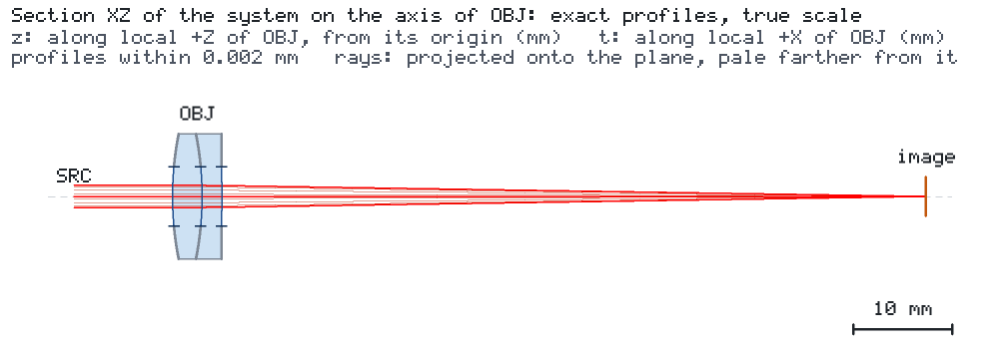

# Three-colour imaging with a declared achromatic objective

[简体中文](README.zh-CN.md) · [Agent case sheet](CASE.md)

A 75 mm cemented doublet images a distant on-axis point at the Fraunhofer F, d and C lines. The question is
whether one fixed image plane gives a small geometric spot and useful diffraction contrast across all three
colours. The saved native imaging analysis supplies the PSF, tangential/sagittal MTF and encircled energy.



## Model and requirement

The released `lens.achromat` builder generated this original prescription with declared SCHOTT N-BK7 and N-F2
Sellmeier coefficients. The [material sources and prescription](data/README.md) give its provenance. The model
has spherical radii 32.732120, −32.732120 and −984.019095 mm, crown/flint centre thicknesses 3/2 mm, and a
12.7 mm outer diameter. Its **6 mm clear diameter** bounds the pupil on all three surfaces; nominal f-number
is 12.5. Interfaces use the Engine's uncoated Fresnel transmission, with zero declared bulk absorption.

PSF/MTF require a bounded pupil. An unbounded model returns UNKNOWN with `PUPIL_NOT_BOUNDED`; give the
design a physical aperture or explicitly bound the imaging launch with `launch_radius_beam_radii`.
This case uses the physical clear apertures above, so no numerical launch-radius cutoff is needed.

| Input | Definition |
| --- | --- |
| Object and field | One on-axis point at infinity; parallel launch rays from a plane phase front at x=−10 mm |
| Wavelengths | 486.1327 / 587.5618 / 656.2725 nm; equal incident powers, 1 mW total |
| Source representation | M²=1 Gaussian, waist radius 1 mm at its source; linear polarization along local x |
| Imaging illumination | Native imaging replaces the Gaussian pupil rings by uniform illumination across the bounded pupil |
| Common image plane | x=76.478991 mm, d-line paraxial back focus plus the 5 mm lens thickness; no per-colour refocus |
| Baseline sampling | Launch grid 48, internally doubled to 96; 128² PSF map over ±80 µm; centroid reference |
| Frequencies | 0, 10, 20, 40 cycles/mm; dimensionless MTF |

Results are **per wavelength**, with each PSF normalized by its transmitted energy (1/µm²). Equal incident
weights are recorded; no polychromatic MTF is constructed by averaging magnitudes. Encircled-energy radii
are measured around the peak and use total transmitted light as the denominator. The diffraction reference
uses the same traced pupil and amplitudes with phase error removed. At this rotationally symmetric on-axis
field, T/S curves overlap at plot resolution (difference <0.0001); linear polarization gives weak Fresnel apodization.

The native Project targets use `spot_rms_mm` on Gaussian equal-power pupil rings (≤5 µm for each line) and
the d-line `spot_centroid_u_mm/v_mm` (±50 µm). These support ordinary `results targets` and Kit studies.
The distinct **derived imaging checks** read KNOWN native analysis quantities: uniform-pupil geometric RMS
≤2 µm, 50% energy radius ≤5 µm, and T/S MTF ≥0.85/0.75/0.55 at 10/20/40 cycles/mm. The spot allowance is
below the 7.4–10.0 µm first-zero Airy radii of this pupil; the energy and contrast bounds retain useful image
quality at the longest wavelength. Additional derived checks are d-line EFL 75 mm ±1% and minimum-geometric-RMS
focus span ≤0.06 mm. Thresholds remain fixed in the defocused and perturbed examples.

## Run and vary

```bash
python -m pip install "os-optics[protected]==0.13.0" "os-optics-kit[plot,render]"
os-optics-kit cases copy achromatic-imaging --dest .
cd achromatic-imaging
os-optics-kit cases verify achromatic-imaging
python workflow.py all --out output
```

Chrome/Chromium is needed for the system view. Run stages separately with `compute`, `study`, `report` and `present`.
Choose a new directory for a new scientific run; existing study directories are refused.

```bash
python workflow.py compute --out shifted --image-shift-mm 0.05
python workflow.py study --out shifted
python workflow.py report --out output
python workflow.py present --out output --dest figures-zh-dark --language zh-CN --background dark
os-optics results imaging output/nominal/run --monitor image --request imaging-request.json
```

The last command is the direct Engine equivalent of the saved baseline imaging calculation. Imaging performs
a dense ray calculation; `workflow.py present` instead reads the saved JSON without tracing. Kit's native
presentation types cover the system view; `figures.py` adapts the imaging arrays into PSF/MTF/energy and study
panels using Kit's theme, provenance, gallery and bundle APIs. Use the case's `present` command to redraw the
complete set. `--language en|zh-CN` and `--background light|dark` provide four variants.
The native `presentation.json` describes the system view; the full gallery registers all five assets in
`assets.json`. Rebuild the native view into its own gallery with
`os-optics-kit present build output/presentation/presentation.json --out native-view`.
`workflow.py report --out output` refreshes the bilingual case tables from saved results.

## Baseline and studies

At the shared image plane the full-pupil RMS radii are 0.869/0.421/0.614 µm, and the 50% energy radii are
approximately 3.27/3.92/4.39 µm. All five native targets are MET and the derived nominal checks pass.
Moving the image plane by +0.15 mm keeps the same criteria and supplies an unmet derived comparison.
The compact [numerical snapshot](data/snapshot.json) records values and Engine identity.

Diagnostic best focus minimizes **full-pupil geometric RMS**, using its squared radius at offsets −0.1, 0,
+0.1 mm. A quadratic gives each minimum; an additional native evaluation verifies each prediction. The
F/d/C offsets are +30.62/−14.00/+20.97 µm, a 44.62 µm span. This is distinct from the paraxial BFLs
71.516656/71.478991/71.516656 mm and from quality at the one common plane. Native pupil refinement and an
independent circular-pupil MTF formula provide sampling/reference checks.

Sensitivity perturbs the written prescription, without re-solving the doublet: R1 and R2 by ±0.05%/±0.1%,
crown thickness by ±10/±20 µm, and image-plane position by ±25/±50 µm. Kit records two-step finite differences
of the native d-line target. The imaging ranking uses the largest absolute full-pupil RMS change across the
three wavelengths and these declared steps; it depends on their scales. The image-plane perturbation is a
focus-setting diagnostic, while all manufacturing and alignment samples retain the fixed image plane.

The tolerance example draws 16 independent mount errors with seed 20261111: decentre along local x/y uniform
±50 µm, and tilt about local x/y normal σ=0.02°, truncated at 3σ. These are explicit illustrative assembly
assumptions. The nominal sample is excluded from pass fractions; native target counts and derived imaging
counts remain separate. All samples and failures are retained. Study imaging uses grid 24 doubled to 48.

Primary-path Gaussian throughput is approximately 90.1–90.4%; the saved monitor record retains secondary-light
power completeness and bound fields. The uniform-grid pupil-area estimate records geometric clipping separately.
The native `geometric_mtf` applicability record identifies the diffraction-dominated regime; the reported
contrast uses native diffraction MTF.

## Outputs

`nominal/` and `defocused/` contain native runs, `imaging.json` and `metrics.json`; `focus/` contains the
diagnostic plane evaluations and paraxial results. `sensitivity/` and `tolerance/` retain specifications,
every sample, native summaries and imaging summaries. `report-en/` and `report-zh-CN/` add the case interpretation
to Kit's factual report. `presentation/index.html` is an offline gallery; `presentation.zip` is a shareable
asset bundle. The bundle includes plotted data, bilingual captions and provenance. Copy the output tree and
case scripts together to recalculate figures from saved runs; the asset bundle itself opens without those runs.
