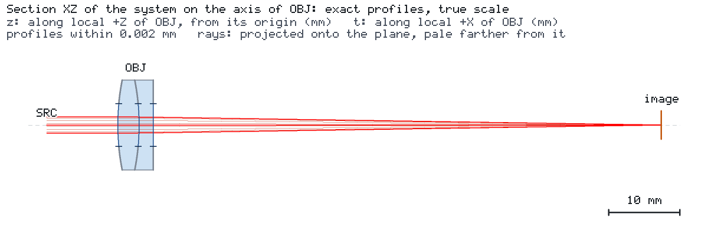

# 声明式消色差物镜的三色成像

[English](README.md) · [智能体案例说明](CASE.md)

一个 75 mm 胶合双透镜对无穷远轴上点在夫琅禾费 F、d、C 三条谱线上成像。核心问题是：在同一固定像面上，
三个波长能否同时获得小几何光斑和有用的衍射对比度？保存的原生成像分析给出 PSF、子午/弧矢 MTF 和包围能量。




两幅图都是引擎对 `project.json` 一次运行的无浏览器快照：`os-optics view run --no-browser --snapshot DIR` 加 `--views iso --size 960x540` 运行一次，再加 `--section ALL --frame=scene --size 1200x420` 运行一次。
在 kit 检出目录中，`os-optics-kit cases images achromatic-imaging` 会按 `images.json` 中的记录原样重新渲染这些视图。

## 模型与要求

本例使用已发布的 `lens.achromat` 构建器以及 SCHOTT N-BK7、N-F2 的 Sellmeier 系数生成原创处方。
[材料来源与处方](data/README.zh-CN.md)说明数据来源。三个球面半径为 32.732120、−32.732120、−984.019095 mm，
冠玻璃/火石玻璃中心厚度为 3/2 mm，外径为 12.7 mm。三个表面的 **6 mm 通光直径**限定孔径，标称光圈数为 12.5。
界面采用引擎的未镀膜菲涅耳透射模型，声明的体吸收为零。

PSF/MTF 需要有界孔径。无界模型返回 UNKNOWN 和 `PUPIL_NOT_BOUNDED`；应为设计增加物理孔径，
或用 `launch_radius_beam_radii` 显式限定成像发射范围。本例使用上述物理通光孔径，无需数值发射半径截断。

| 输入 | 定义 |
| --- | --- |
| 物体与视场 | 无穷远轴上点；从 x=−10 mm 的平面波前发射平行光线 |
| 波长 | 486.1327 / 587.5618 / 656.2725 nm；入射线功率相等，总功率 1 mW |
| 光源表示 | M²=1 高斯光束，光源处束腰半径 1 mm，沿局部 x 方向线偏振 |
| 成像照明 | 原生成像分析以均匀照明的有界孔径网格替代高斯等功率环 |
| 共同像面 | x=76.478991 mm，即 d 线近轴后焦距加 5 mm 镜片厚度；不逐波长重新调焦 |
| 基线采样 | 发射网格 48，内部加密至 96；±80 µm 的 128² PSF 图；质心参考 |
| 频率 | 0、10、20、40 cycles/mm；MTF 无量纲 |

结果**逐波长**报告；每幅 PSF 按该波长的透射能量归一化，单位为 1/µm²。记录等入射权重，不把各 MTF 幅值
平均为多色 MTF。包围能量以峰值为中心、以透射总能量为分母。衍射参考保持相同追迹孔径及振幅，去除相位误差。
本轴上旋转对称视场的 T/S 曲线在绘图分辨率下重合（差异<0.0001）；线偏振产生微弱的菲涅耳切趾。

原生 Project 目标为高斯等功率孔径环的 `spot_rms_mm`（每条谱线≤5 µm），以及 d 线
`spot_centroid_u_mm/v_mm`（±50 µm）。它们用于常规 `results targets` 和 Kit 研究。
独立的**派生成像检查**读取状态为 KNOWN 的原生分析量：均匀孔径几何 RMS≤2 µm、50% 能量半径≤5 µm，
10/20/40 cycles/mm 处 T/S MTF≥0.85/0.75/0.55。几何光斑限值小于此孔径 7.4–10.0 µm 的艾里第一暗环半径；
能量与对比度限值保证最长波长仍有实用成像质量。另检查 d 线 EFL 为 75 mm±1%，最小几何 RMS 焦点跨度≤0.06 mm。
离焦与扰动示例保持这些限值。

## 运行与变化

```bash
python -m pip install "os-optics[protected]==0.13.0" "os-optics-kit[plot,render]"
os-optics-kit cases copy achromatic-imaging --dest .
cd achromatic-imaging
os-optics-kit cases verify achromatic-imaging
python workflow.py all --out output
```

`all` 最后执行 `present`，生成可选的展示图库，它需要 `render` 扩展和 Chrome/Chromium。
也可分别执行 `compute`、`study`、`report`、`present`。新的科学计算使用新输出目录；已有研究目录会被拒绝覆盖。

```bash
python workflow.py compute --out shifted --image-shift-mm 0.05
python workflow.py study --out shifted
python workflow.py report --out output
python workflow.py present --out output --dest figures-zh-dark --language zh-CN --background dark
os-optics results imaging output/nominal/run --monitor image --request imaging-request.json
```

最后一条是基线成像计算的直接引擎命令。成像分析会执行密集光线计算；`workflow.py present` 只读取保存的 JSON，
不追迹。Kit 原生展示类型绘制图库中的三维视图；`figures.py` 使用 Kit 主题、来源记录、图库和打包 API，把成像数组转换成
PSF/MTF/能量及研究图。完整重绘使用案例的 `present` 命令。`--language en|zh-CN` 和
`--background light|dark` 组合得到四种展示版本。
原生 `presentation.json` 描述该三维视图；完整图库通过 `assets.json` 登记全部五张图。
使用 `os-optics-kit present build output/presentation/presentation.json --out native-view`
可将原生视图重建到独立图库。`workflow.py report --out output` 从保存结果刷新双语案例表格。

## 基线与研究

共同像面的全孔径 RMS 半径为 0.869/0.421/0.614 µm，50% 能量半径约为 3.27/3.92/4.39 µm。
五个原生目标均为 MET，标称派生检查均通过。像面移动 +0.15 mm 的比较保留相同准则及未满足的派生检查。
[数值快照](data/snapshot.json)记录数值和引擎身份。

诊断最佳焦点定义为**全孔径几何 RMS 最小值**：在 −0.1、0、+0.1 mm 像面偏移处求半径平方，拟合二次函数，
并在预测极小值处追加原生计算验证。F/d/C 偏移为 +30.62/−14.00/+20.97 µm，跨度为 44.62 µm。
它区别于近轴后焦距 71.516656/71.478991/71.516656 mm，也区别于共同像面的成像质量。
原生孔径加密和独立圆孔径 MTF 公式提供采样与参考检查。

灵敏度直接扰动已写出处方，不重新求解双透镜：R1/R2 为 ±0.05%/±0.1%，冠玻璃厚度为 ±10/±20 µm，像面位置
为 ±25/±50 µm。Kit 记录原生 d 线目标的双步长有限差分。成像排序使用三个波长及声明步长内全孔径 RMS 的
最大绝对变化，因此排序依赖扰动尺度。像面扰动用于焦面设定诊断；制造和装调采样保持固定像面。

公差例以种子 20261111 独立采样 16 次：局部 x/y 偏心为 ±50 µm 均匀分布，局部 x/y 倾斜为 σ=0.02°、
截断于 3σ 的正态分布。这些是明确的示例装配假设。标称样本不计入通过率；原生目标计数与派生成像计数分开。
保留全部样本及失败结果。研究成像使用 24 网格并内部加密至 48。

主路径高斯功率透射率约为 90.1–90.4%；保存的监视面记录保留次级光功率的完整性及界限字段。
均匀网格的孔径面积估计单独记录几何截光。原生 `geometric_mtf` 适用性记录指出这里处于衍射主导区域；
展示的对比度取原生衍射 MTF。

## 输出

`nominal/`、`defocused/` 包含原生运行、`imaging.json` 和 `metrics.json`；`focus/` 保存诊断像面计算及近轴结果。
`sensitivity/`、`tolerance/` 保留研究规格、每个样本、原生记录和成像汇总。`report-en/`、`report-zh-CN/`
在 Kit 事实报告中加入案例说明。`presentation/index.html` 为离线图库，`presentation.zip` 为可分享的图件包，
包含绘图数据、双语图注和来源记录。保存输出树与案例脚本可从既有运行重绘；图件包本身无需这些运行即可浏览。
