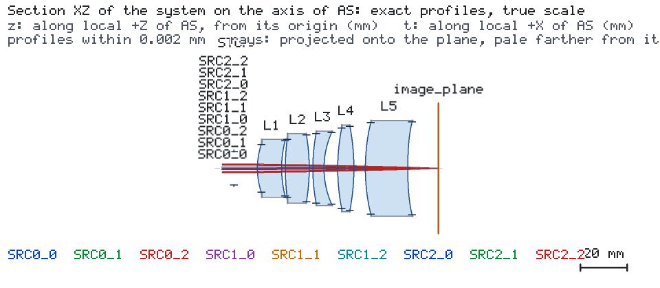
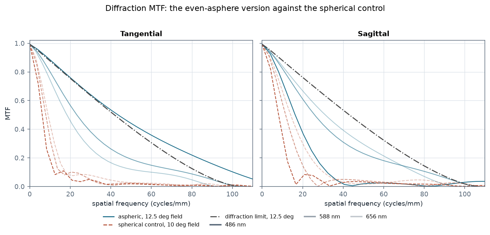
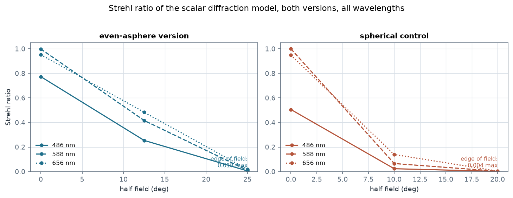
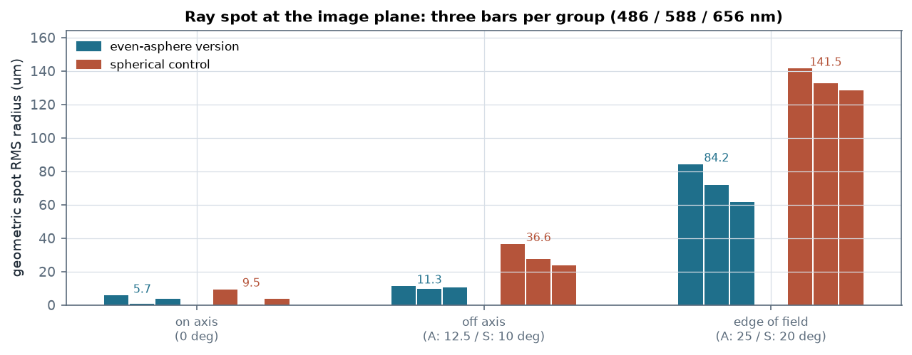

# Even aspheres carry a five-element f/3.5 lens to 25° half field

A five-element lens for the visible band (N-BK7, N-BK7, F2, N-BK7, F2) at F/3.5 and 50 mm focal
length, designed for a 25° half field and evaluated at 486, 588 and 656 nm. Four surfaces carry an
even asphere: a conic plus an A4 term. To show what the aspheres buy, the same elements were also
optimised with every radius spherical, and both versions went through the engine under identical
conditions — same stop, same source, same budget, same imaging request.

## The lens



The stop ahead of the first element opens to 7.143 mm, which sets F/3.5 for a 50 mm focal length.
The aspheric terms sit on S1 and S3 (the first element) and on S9 and S10 (the last one):

| surface | role | conic | A4 |
| --- | --- | --- | --- |
| S1 | front of L1 | −1.7752 | 2.064e−06 |
| S3 | back of L1 | 42.8691 | −9.612e−06 |
| S9 | front of L5 | 9.6022 | −2.047e−06 |
| S10 | back of L5 | 4.0369 | 4.320e−06 |

The A4 terms do real work: at the clear radius of S10, A4·r⁴ is 0.0032 mm, well inside the sag of
the surface but enough to trim the outer zone where the spherical version cannot.

## What the aspheres buy



| | even-asphere version | spherical control |
| --- | --- | --- |
| half field | 0, 12.5, 25° | 0, 10, 20° |
| Strehl on axis | 0.773 / 0.999 / 0.952 | 0.505 / 1.000 / 0.948 |
| Strehl off axis | **0.254 / 0.416 / 0.483** | 0.023 / 0.065 / 0.139 |
| ray spot off axis | **9.87–11.32 µm** | 23.70–36.59 µm |
| sources on the plane | 9/9, 14 quantities each | 9/9, 14 quantities each |
| KNOWN quantities | 110 of 126 | 114 of 126 |



The spherical control holds its first field only out to 20° — past that its rays stop reaching the
image plane at all — and even there its off-axis Strehl ratio is 0.023–0.139. The aspheric version
is at 0.254–0.483 on a field 25 % further out. On axis the two are comparable; the difference is
entirely in the outer field, which is exactly where a five-element f/3.5 lens fails when every
surface is spherical.

The control also pays by hiding in near-plane surfaces: to hold 20° it drives S4 to R = 443 mm and
S10 to R = −794 mm. The aspheric version keeps every radius between −96 mm and +100 mm.



## Reading the engine's verdict

The run status is **FAIL** and `in_model_scope` is **false**, and neither is a statement about the
optics. The engine files two findings:

- `GAUSSIAN_ABERRATION_DOMINATED`: *"the Engine's pupil rays spread 4.65 times as wide as an
  aberration-free beam with this Gaussian envelope can (… limit 2): the beam is aberration dominated
  and its Gaussian metrics are not valid"*. A 25° wide-field lens is not a Gaussian-beam system;
  this finding says the Gaussian model does not describe it. It is not a quality measure.
- `GAUSSIAN_SEVERE_TRUNCATION`: *"aperture truncates 0.1462 of the beam power"* at L5's rear face,
  where the outermost field's beam meets the ground edge.

What the engine does still report is the imaging chain:
`results imaging` returns 14 quantities for each of the nine sources, and **110 of the 126 are
KNOWN** — image-space NA, ray spot, wavefront RMS and PV, Strehl ratio, tangential and sagittal
diffraction MTF with its limit, and the 50 % / 80 % encircled radii. The 16 it declines are the
`geometric_mtf_*` pair of eight fields, with the reason `GEOMETRIC_REGIME_NOT_MET`: *"the wavefront
error (0.0797 waves RMS) is below 1.0 wave: diffraction sets the MTF here, and the diffraction MTF is
the one to read"*. That is the same boundary the mid-wave infrared case shows from the other side:
a lens good enough to be diffraction limited has no meaningful ray-based MTF.

The nine targets are `spot_rms_mm` at 0.05 mm: six MET (on axis 1.00–5.42 µm, 12.5° 9.80–11.08 µm)
and three UNMET at 25° (61.93–86.22 µm). `expected.json` records that verdict as it stands.

## Reproducing it

```bash
os-optics project check project.json
os-optics project run project.json --out-dir run
os-optics results targets run
os-optics results imaging run --monitor image_plane --request imaging-request.json
```

`data/engine-aspheric.json` holds both versions side by side: every quantity with its state, basis and —
where the engine declined it — the reason and message verbatim. `studies/aspheric.csv` and
`studies/spherical-control.csv` are the two surface tables; `prescription.csv` is the aspheric one.

The surface table imports directly:

```bash
os-optics project import-prescription prescription.csv --model-id AS
```
