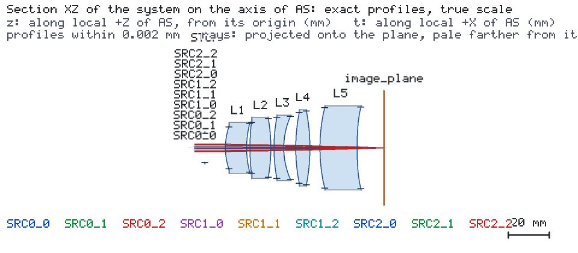
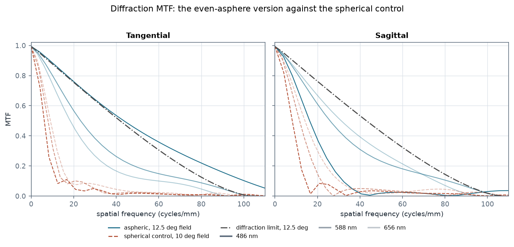
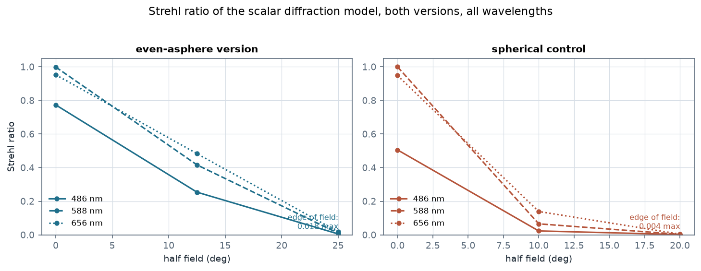
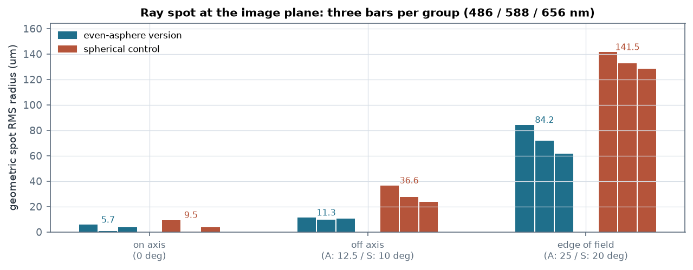

# 偶次非球面把 5 片 f/3.5 镜头带到 ±25° 半视场

一个可见光波段的 5 片镜头（N-BK7、N-BK7、F2、N-BK7、F2），F/3.5、焦距 50 mm，按 ±25° 半视场设计，
在 486、588、656 nm 三个波长上评价。四个面各带一个偶次非球面：一个 conic 加一个 A4 项。为了说明
非球面到底带来了什么，同样的元件结构又被解了一遍、但全部为球面，两个版本在**完全相同的条件**下送进
引擎——同一光阑、同一光源、同一预算、同一成像请求。

## 镜头



首片之前的光阑开孔 7.143 mm，对 50 mm 焦距即 F/3.5。非球面项落在 S1、S3（第一片）与 S9、S10
（最后一片）：

| 面 | 位置 | conic | A4 |
| --- | --- | --- | --- |
| S1 | L1 前表面 | −1.7752 | 2.064e−06 |
| S3 | L1 后表面 | 42.8691 | −9.612e−06 |
| S9 | L5 前表面 | 9.6022 | −2.047e−06 |
| S10 | L5 后表面 | 4.0369 | 4.320e−06 |

A4 项确实在做功：在 S10 的通光半径上，A4·r⁴ 为 0.0032 mm——远小于该面的垂度，但足以把球面版
修不动的边缘带压下去。

## 非球面买到了什么



| | 偶次非球面版 | 球面控制版 |
| --- | --- | --- |
| 半视场 | 0、12.5、25° | 0、10、20° |
| 轴上 Strehl | 0.773 / 0.999 / 0.952 | 0.505 / 1.000 / 0.948 |
| 离轴 Strehl | **0.254 / 0.416 / 0.483** | 0.023 / 0.065 / 0.139 |
| 离轴弥散斑 | **9.87–11.32 µm** | 23.70–36.59 µm |
| 到达像面的光源 | 9/9，各 14 个量 | 9/9，各 14 个量 |
| KNOWN 量 | 110 / 126 | 114 / 126 |



球面控制版的视场只撑到 20°——再往外它的光线根本到不了像面——而且就在 20° 上，离轴 Strehl
比只有 0.023–0.139。非球面版在**再往外 25%** 的视场上保持着 0.254–0.483。轴上两者相当；差别
全在外场，而那正是一片全球面的 5 片 f/3.5 镜头失效的地方。

控制版还付出了另一笔代价：它靠近乎平面的面躲了过去——为撑住 20°，S4 被推到 R = 443 mm、
S10 被推到 R = −794 mm。非球面版的每个半径都落在 −96 mm 到 +100 mm 之间。



## 怎么读引擎的判定

运行状态是 **FAIL**，`in_model_scope` 是 **false**，这两条都不是在说光学设计的好坏。引擎给出了
两条发现：

- `GAUSSIAN_ABERRATION_DOMINATED`：*"the Engine's pupil rays spread 4.65 times as wide as an
  aberration-free beam with this Gaussian envelope can (… limit 2): the beam is aberration dominated
  and its Gaussian metrics are not valid"*。一个 ±25° 的宽视场镜头本来就不是高斯光束系统；这条
  发现的意思是**高斯模型不适合描述它**，而不是质量指标。
- `GAUSSIAN_SEVERE_TRUNCATION`：*"aperture truncates 0.1462 of the beam power"*，发生在 L5 后表面，
  即最外场的光束碰到了磨边。

引擎仍然给的是成像链路本身：`results imaging` 为九个光源各返回 14 个量，**126 个里有 110 个是
KNOWN**——像方 NA、弥散斑、波前 RMS 与 PV、Strehl 比、切向与弧矢衍射 MTF 及其极限、50% 与 80%
包围圆半径。它拒绝的 16 个是八个视场的 `geometric_mtf_*`，理由是 `GEOMETRIC_REGIME_NOT_MET`：
*"the wavefront error (0.0797 waves RMS) is below 1.0 wave: diffraction sets the MTF here, and the
diffraction MTF is the one to read"*。这与中红外案例展示的是同一个边界，只是从另一侧看：一个已经
接近衍射极限的镜头，没有有意义的几何 MTF。

九条目标都是 `spot_rms_mm`、上限 0.05 mm：6 条 MET（轴上 1.00–5.42 µm，12.5° 9.80–11.08 µm），
3 条在 25° 处 UNMET（61.93–86.22 µm）。`expected.json` 如实记录了这个判定。

## 复现

```bash
os-optics project check project.json
os-optics project run project.json --out-dir run
os-optics results targets run
os-optics results imaging run --monitor image_plane --request imaging-request.json
```

`data/engine-aspheric.json` 把两个版本并排放：每一个量连同它的状态、依据，以及引擎拒绝时的 `reason`
与 `message` 原文。`studies/aspheric.csv` 与 `studies/spherical-control.csv` 是两个面型表，
`prescription.csv` 是非球面版。

面型表可直接导入：

```bash
os-optics project import-prescription prescription.csv --model-id AS
```
