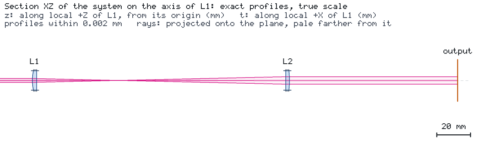
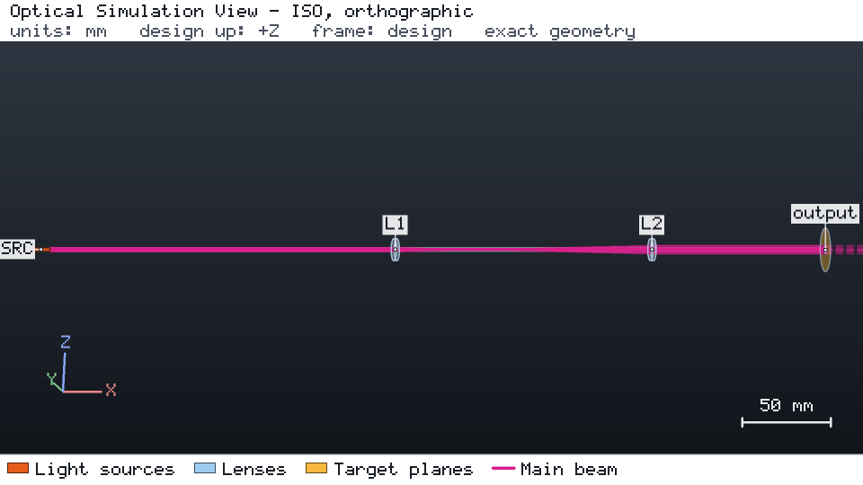

# Catalog beam expander

Two catalog plano-convex lenses (f = 50 mm and 100 mm, N-BK7, 12.7 mm diameter) expand a 780 nm Gaussian beam with a
1 mm waist radius twice. The target `expanded_waist` asks for an output waist radius of 1.9961 mm ± 1 %, a measure
of collimation. The components pin catalog release 2026-10-28.1.





## Run it

```bash
os-optics-kit cases copy beam-expander --dest .
cd beam-expander
os-optics project run project.json --out-dir run
os-optics results targets run
```

## Results

| Target | Value | Bound | Assessment |
| --- | --- | --- | --- |
| `expanded_waist` | 1.99607 mm | 1.99612 mm ± 1 % | MET |

## Swap a lens and restore collimation

The study files in `studies/` change the design by ID with `os-optics-kit edit` and `os-optics-kit sweep`:

| Step | Design | `expanded_waist` | Outcome |
| --- | --- | --- | --- |
| Swap L2 for a fused-silica lens, f = 100.3 mm | `swapped.json` | 1.4407 mm | FAIL |
| Sweep L2 along the beam, −1 … +2 mm, 12 samples | `l2-sweep/` | 0.7323 … 2.0098 mm | 5 PASS, 7 FAIL |
| Move L2 by the best shift, +0.54 mm | `final.json` | 1.99645 mm | PASS |

The beam radius at the output plane (`output_beam_radius`, added by the swap) stays within 1 % throughout: the
waist radius reacts to collimation, the radius at one plane barely does. Verified with os-optics 0.12.0 and catalog
2026-10-28.1; run status PASS.
