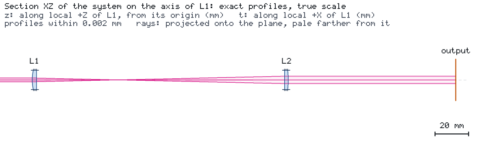
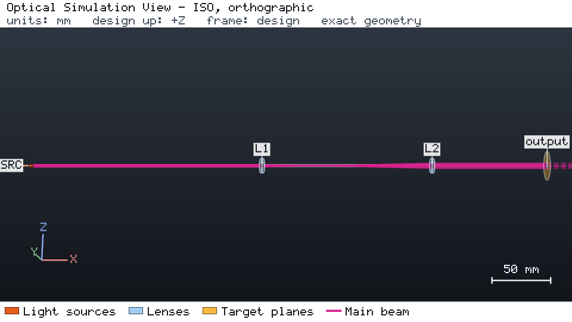

# 目录扩束器

两片目录中的平凸透镜（f = 50 mm 与 100 mm，N-BK7，直径 12.7 mm）把波长 780 nm、束腰半径 1 mm 的高斯光束扩束两倍。
目标 `expanded_waist` 要求输出束腰半径为 1.9961 mm ± 1 %，用于衡量准直程度。元件固定在目录版本 2026-10-28.1。





## 运行

```bash
os-optics-kit cases copy beam-expander --dest .
cd beam-expander
os-optics project run project.json --out-dir run
os-optics results targets run
```

## 结果

| 目标 | 数值 | 界限 | 评估 |
| --- | --- | --- | --- |
| `expanded_waist` | 1.99607 mm | 1.99612 mm ± 1 % | MET |

## 更换透镜并恢复准直

`studies/` 中的研究文件通过 `os-optics-kit edit` 与 `os-optics-kit sweep` 按 ID 修改设计：

| 步骤 | 设计 | `expanded_waist` | 结果 |
| --- | --- | --- | --- |
| 把 L2 换成熔融石英透镜，f = 100.3 mm | `swapped.json` | 1.4407 mm | FAIL |
| 沿光束扫描 L2，−1 … +2 mm，12 个样本 | `l2-sweep/` | 0.7323 … 2.0098 mm | 5 个 PASS，7 个 FAIL |
| 按最佳位移 +0.54 mm 移动 L2 | `final.json` | 1.99645 mm | PASS |

输出面上的光束半径（换镜时新增的 `output_beam_radius`）始终在 1 % 以内：束腰半径对准直敏感，单个面上的半径几乎不变。
已用 os-optics 0.12.0 与目录 2026-10-28.1 验证；运行状态 PASS。
