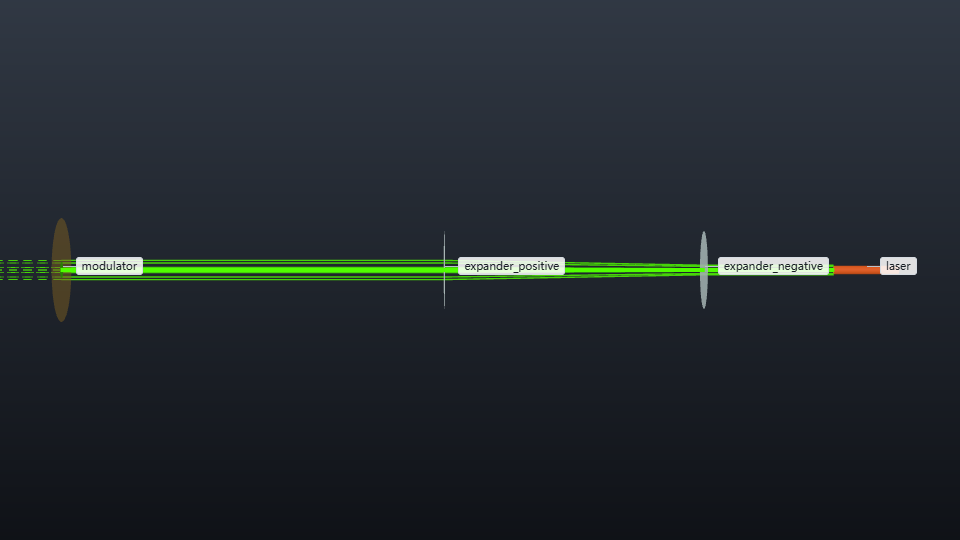

# Intensity-only aberration correction

How much focal intensity can five phase controls recover when spherical aberration
remains uncontrolled? This case optimizes a scalar on-axis intensity sensor and
compares the ideal, disturbed and corrected focal patterns at equal transmitted power.



## Run

```bash
os-optics-kit cases copy bounded-aberration-correction --dest .
cd bounded-aberration-correction
python -m pip install -r requirements-aberration.txt
python workflow.py --out out/default
python workflow.py --out out/stronger --spherical-waves 0.1
python workflow.py --out out/default --redraw-only
```

The external workflow requires Python 3.12+ with the pinned dependencies. From a
checkout, run in this case directory. Each calculation uses a new output directory. The default took about 3 s on Python 3.14.8, os-optics 0.13.0;
no catalog download is needed. Open the generated `preview.png`.

## Optical model and handoff

The engine traces a 532 nm, 20 mW TEM00 source (0.65 mm waist radius) through
ideal −40 mm and +80 mm lenses at z = 20 and 60 mm. Its `handoff` at
z = 119 mm supplies wavelength, two-axis q, power and field applicability.
The engine target `relay_radius` is MET: the 1/e² intensity radius is
1.300312968 mm, within 1.29–1.31 mm.

The external calculation uses this radius and power at a circular pupil of radius
1.5 mm. A fixed phase plate cancels the nominal curvature; the disturbance and
correction then act at the pupil, followed by an ideal 120 mm Fourier lens.
The pupil transmits 18.603049 mW. Its sampled amplitude is normalized to that
analytic aperture power. The sensor is noiseless and the phase controls continuous.
The PSF and correction are external scalar paraxial results; the saved engine run
describes the relay feeding them.

For normalized pupil radius r and azimuth θ, the six phase modes are
√3(2r²−1), √6r²cos2θ, √6r²sin2θ, √8(3r³−2r)cosθ,
√8(3r³−2r)sinθ and √5(6r⁴−6r²+1). Their default coefficients in waves
are [0.24, 0.17, −0.11, 0.12, −0.09, 0.055]. Powell search adjusts only the
first five, each within ±0.6 waves, using scalar sensor readings. The last
coefficient remains fixed. This basis has unit RMS over a uniformly illuminated
unit disk; the actual illumination is Gaussian.

## Results and useful changes

The principal observable is **intensity at the fixed optical-axis position**,
divided by the ideal on-axis intensity with the same aperture and transmitted
power. A displaced focal peak changes this measurement through its intensity
at the original axis position.

| Uncontrolled spherical coefficient | Before correction | After correction | Sensor evaluations |
| --- | --- | --- | --- |
| 0.055 waves | 0.092393 | 0.895105 | 221 |
| 0.100 waves | 0.106409 | 0.692747 | 149 |

Increasing the uncontrolled mode reduces the recovered intensity. The corrected
default defocus is −0.219892 waves: a small residual defocus compensates part
of the spherical phase under the Gaussian weighting.
Try `--bound-waves 0.1` to explore actuator saturation. All evaluations, including
poor trial settings, remain in `science.npz`; convergence checks remain active.

The 160² optimization grid is evaluated on a 512² pupil. A 768² pupil changes
the corrected ratio by 0.000185 (default) and 0.000470 (stronger spherical).
Independent polar Gaussian quadrature gives 0.894818 and 0.692023, respectively;
the absolute differences from the 512² calculation are below 0.00073.
The relay q matches an independent ABCD calculation to 6×10⁻¹⁵ relative error.
Parseval power conservation and direct coherent sum versus FFT center agree to
7×10⁻¹⁶. The default correction is a local bounded optimum.

## Saved results

- `engine/` keeps the normalized engine input, result and ray artifacts.
- `handoff.json` is the engine handoff, with run identity.
- `config.json` holds optical parameters, grids and the input project digest.
- `metrics.json` holds results, checks, versions, runtime and engine target identity.
- `science.npz` holds the complex pupil fields (√W/mm), pupil coordinates (mm),
  phase (waves), a ±80 µm focal intensity crop (W/mm²), its axis (mm), the ideal
  peak, disturbance/correction coefficients and every sensor trial. State order
  is ideal, disturbed, corrected. History columns are the five controls then the
  dimensionless on-axis ratio. The unwrapped pupil phase outside the aperture
  carries no field; use the zero-amplitude mask when plotting it.
- `preview.png` uses one shared linear intensity scale. Redraw reads only saved
  arrays with the existing calculation settings.

The Fourier calculation uses a 6 mm pupil window and zero pads 512² samples to
2048² for focal sampling. Reconstruct the full focal field from the saved complex
pupil if another crop is needed. Keep generated results outside version control.

## Presentation from saved results (kit 0.4.0)

```bash
python present_case.py out/default out/stronger --out talk/en --language en --background light --size 1920x1080 --bundle talk/aberration-en.zip
python present_case.py out/default out/stronger --out talk/zh --language zh-CN --background light
python present_case.py out/default out/stronger --out talk/dark --language zh-CN --background dark
os-optics-kit present gallery talk/en
os-optics-kit present bundle talk/en --out talk/share.zip --only psf,response
```

Open `talk/en/index.html` offline. The gallery combines the Gaussian relay and
its beam-radius target with the external scalar Fourier PSFs and on-axis intensity
comparison. `psf` shows the first run's three states on a shared linear 0–1 scale;
`response` normalizes each run to its own equal-power ideal on-axis intensity.
Comparison inputs must use the same optics, grids and control bounds, with the
spherical coefficient as the varied parameter.

The helper reads the saved arrays and metrics and checks the ratios against the
complex pupil fields. Use a new `--out` for each style. Chrome/Chromium supports
the relay view; Chinese text needs a font such as Microsoft YaHei or Noto Sans CJK SC.

Use the `present_case.py` commands above to rebuild the complete gallery from
saved run folders, passing their new locations if moved. `presentation.json`
covers the native radius-target plot; running `present build` on that file
replaces the gallery index with that plot. The complete gallery includes PNG,
SVG plots, bilingual captions, data snapshots and source hashes. Camera settings,
data origin, units, normalization and selection are recorded alongside each asset
in its provenance and redraw files.

The ZIP carries an offline gallery and external plotting snapshots. After
extracting `aberration-en.zip`, run its included helper to redraw a snapshot:

```bash
python aberration-en/assets/psf/present_case.py --redraw-external aberration-en/assets/psf/redraw.json --out psf-zh --language zh-CN --background dark
python aberration-en/assets/response/present_case.py --redraw-external aberration-en/assets/response/redraw.json --out response-zh --language zh-CN --background dark
```

These commands use the packaged data and retain the saved theme unless a style
option is supplied. Rebuilding the complete relay and PSF gallery requires the
original saved run folders and the full-gallery command above.
