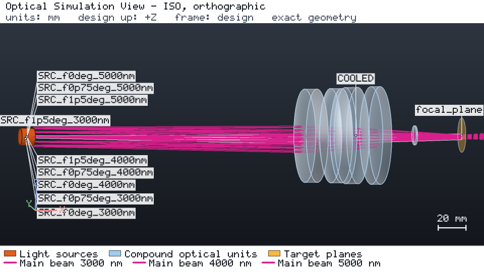
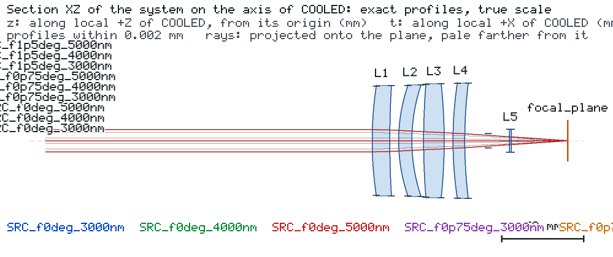

# A cooled 3-5 µm imager with the cold stop as its aperture stop

English · [简体中文](README.zh-CN.md)

A four-element F/2 imager for 3-5 µm whose **aperture stop is the cold stop of
a cooled detector**, in image space 13 mm in front of the focal plane.

| | |
|---|---|
| Band | 3-5 µm (3.0 / 4.0 / 5.0 µm traced) |
| EFL | 99.07 mm (target 100 mm) |
| Focal ratio | F/2 (entrance pupil 50 mm) |
| Half field | 1.5° |
| Elements | 4: Si, ZnSe, CaF2, Sapphire |
| Cold stop | 9.0 mm at CSH = 13 mm |
| Detector window | 1 mm Si |






## Why the stop placement is the point

In a cooled infrared camera the aperture stop is the **cold shield opening of
the detector** — a 77 K plate in *image* space. Everything the detector sees
through it is scene; everything outside it is cold metal. That is not a bench
convenience, it is the physical definition of the stop, and it changes two
things a visible-band layout does not have to think about.

**The focal ratio follows from the stop and its distance.** With the stop
`CSH = 13 mm` before the focal plane, the on-axis cone subtends
`atan(D / (2·CSH))`, so the smallest stop that passes it is `D = CSH / F# =
6.5 mm` at F/2. The entrance pupil, `D = EFL / F# = 50 mm`, is the *image* of
that stop through the front group — so the front elements carry a 25 mm beam
even though the stop itself is small.

**A stop at that minimum vignettes every off-axis field.** The beam walks
across the stop as the field angle grows. At 1.5° the marginal ray lands
outside the axial footprint, so a stop at 6.5 mm would cut the outer field.
This design uses **9.0 mm**, measured from the traced pupil rays rather than
assumed. The focal ratio stays 2.0 because it is set by the entrance pupil,
not by the stop's own diameter — a distinction that is easy to miss when the
stop is drawn as "just another aperture".

## Results

Spot RMS on the focal plane, all nine field/wavelength pairs (bound 0.08 mm):

| field | 3.0 µm | 4.0 µm | 5.0 µm |
|---|---|---|---|
| 0° | 0.0261 | 0.0045 | 0.0177 |
| 0.75° | 0.0248 | 0.0043 | 0.0167 |
| 1.5° | 0.0207 | 0.0034 | 0.0141 |

All nine targets are MET.

## What the engine reports, and why

`OUT_OF_MODEL_SCOPE` — some pupil rays of the outer field meet the stop's rim
while the chief ray does not. A stop *necessarily* clips the pupil for an
off-axis field; the engine follows each beam along its chief ray, so it can
say "part of this beam is cut" but cannot compute the power of the surviving
part. The spot values above are geometric and remain valid.

`BULK_LOSS_NOT_ESTABLISHED` for all four materials — the public catalog's
3-5 µm entries carry dispersion and a validity band but no measured bulk
absorption at these wavelengths. The transmitted power is therefore an upper
bound; the spot values do not depend on it.

## Run

```bash
os-optics project run project.json --out-dir run
os-optics results targets run
```
