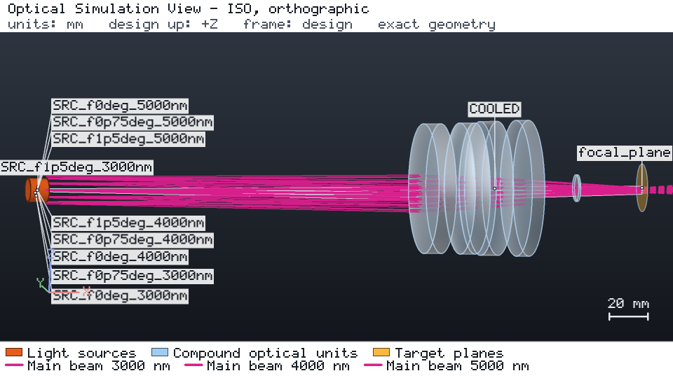
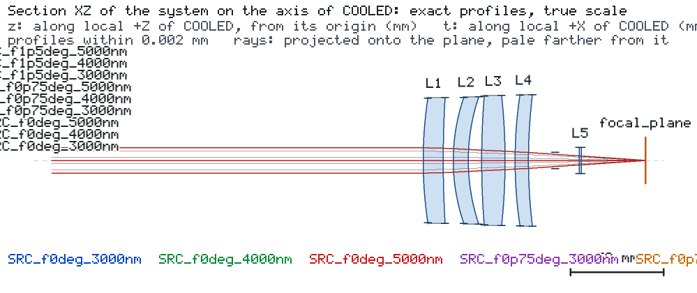

# 制冷中波成像器：以冷光阑为孔径光阑

[English](README.md) · 简体中文

一个 3-5 µm 的四片式 F/2 成像器，其**孔径光阑就是制冷探测器的冷光阑**，位于像方、
焦平面前 13 mm 处。

| | |
|---|---|
| 波段 | 3-5 µm（追迹 3.0 / 4.0 / 5.0 µm） |
| 焦距 | 99.07 mm（目标 100 mm） |
| F 数 | F/2（入瞳 50 mm） |
| 半视场 | 1.5° |
| 片数 | 4 片：Si、ZnSe、CaF2、蓝宝石 |
| 冷光阑 | Ø9.0 mm，CSH = 13 mm |
| 探测器窗口 | 1 mm Si |






## 为什么"光阑位置"才是重点

制冷红外相机的孔径光阑不是台面上的方便之物，而是**探测器的冷屏开口**——一块位于
*像方*的 77 K 板。探测器透过它看到的都是场景，开口之外都是冷金属。这改变了可见光
布局不必考虑的两件事。

**F 数由光阑及其距离决定。** 光阑在焦平面前 `CSH = 13 mm`，轴上光锥张角为
`atan(D / (2·CSH))`，所以通过轴上光锥的最小光阑是 `D = CSH / F# = 6.5 mm`（F/2）。
而入瞳 `D = EFL / F# = 50 mm` 是这个光阑经前组的*像*——所以前组要承载 25 mm 光束，
尽管光阑本身很小。

**恰好取最小直径的光阑会让所有离轴视场渐晕。** 视场角增大时，光束在光阑上横向游走。
1.5° 时边缘光线已落在轴上足迹之外，若光阑仍是 6.5 mm 就会切掉外视场。本设计用
**Ø9.0 mm**，这个数是从追迹的瞳孔光线量出来的，不是估的。F 数仍是 2.0，因为它由
入瞳决定，不由光阑自身直径决定——当光阑被画成"又一个孔径"时，这个区别很容易被忽略。

## 结果

焦平面上的 spot RMS，九个视场/波长组合（上限 0.08 mm）：

| 视场 | 3.0 µm | 4.0 µm | 5.0 µm |
|---|---|---|---|
| 0° | 0.0261 | 0.0045 | 0.0177 |
| 0.75° | 0.0248 | 0.0043 | 0.0167 |
| 1.5° | 0.0207 | 0.0034 | 0.0141 |

九个目标全部 MET。

## 引擎报告了什么，为什么

`OUT_OF_MODEL_SCOPE` —— 外视场的部分瞳孔光线碰到光阑边缘，而主光线没有。光阑对
离轴视场*必然*切割瞳孔；引擎沿主光线跟随每条光束，因此能说"这条光束被切了一部分"，
但算不出通过部分的功率。上表的 spot 是几何量，仍然有效。

四个材料都报 `BULK_LOSS_NOT_ESTABLISHED` —— 公开目录里 3-5 µm 的材料有出色散和
有效波段，但没有该波段的实测体吸收。因此透过功率是上界；spot 不依赖它。

## 运行

```bash
os-optics project run project.json --out-dir run
os-optics results targets run
```
