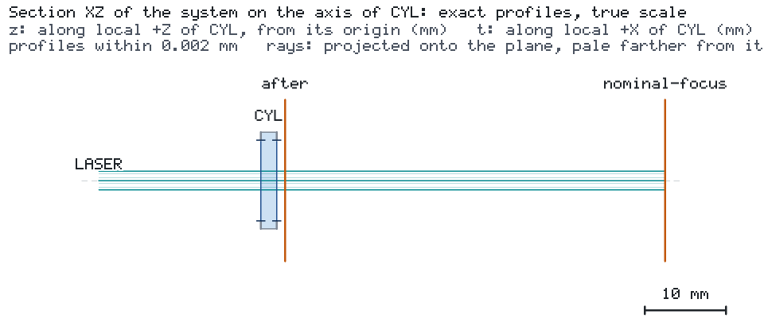

# Cylindrical light-sheet thickness and range

[简体中文](README.zh-CN.md) · [Agent case sheet](CASE.md)

A cylindrical lens focuses one transverse axis of a Gaussian beam. A shorter focal length makes the sheet thinner and shortens the useful propagation range. This case compares the two effects using a real two-interface cylindrical prescription and a separable paraxial Gaussian model.




Both images are the engine's browser-free snapshots of a run of `project.json`:
`os-optics view run --no-browser --snapshot DIR` with `--views iso --size 960x540`, and again with
`--section ALL --frame=scene --size 1200x420`. In a kit checkout,
`os-optics-kit cases images cylindrical-light-sheet` re-renders exactly these views as recorded in
`images.json`.

The source travels along +z at 488 nm with a 1 mm waist radius and 10 mW power. The lens front vertex is at z=20 mm; the 2 mm thick, n=1.52 lens has a curved entrance and plane exit. Its cylinder axis is x, so y focuses. The default entrance radius is 26 mm, the clear diameter is 10 mm, and each surface transmits 0.995 of the power. The refractive index is constant over 450–650 nm. The modeled surfaces are ideal and M²=1.

| Lens focal length | Waist thickness FWHM | Full sqrt(2)-thickness range | Waist z |
| --- | --- | --- | --- |
| 50 mm | 9.14456 um | 0.776659 mm | 70.6824 mm |
| 40 mm | 7.31569 um | 0.497068 mm | 60.6834 mm |
| 65 mm | 11.88777 um | 1.312519 mm | 85.6796 mm |

All three deliver 9.90025 mW. The wide-axis FWHM at the default focus is 1.17748 mm. The 40 mm lens gives a 20% thinner waist with a 36% shorter range. The example targets are waist thickness <=10 um and full range >=0.45 mm; the 40 and 50 mm designs satisfy them. The 65 mm variation extends the range but misses the thickness target (workflow exit code 1).

## Run and change a parameter

From this case directory, use Python 3.12 or later and the pinned dependencies:

```bash
python -m pip install -r requirements-light-sheet.txt
os-optics project run project.json --out-dir ../sheet-native
os-optics results targets ../sheet-native
python workflow.py --out ../sheet-default
python workflow.py --focal-length-mm 40 --out ../sheet-f40
python workflow.py --focal-length-mm 65 --out ../sheet-f65
python workflow.py --out ../sheet-default --plot-only
```

The complete default workflow takes about 4–5 seconds on Windows with Python 3.14, including preview rendering; scientific construction and calculation take about 2 seconds. `--focal-length-mm` accepts 25–110 mm and `--input-waist-mm` accepts 0.5–1.5 mm. Each changed focal length rebuilds the cylindrical prescription from the specified surfaces. Shorter focal lengths or larger input waists reduce thickness and range; the engine assesses each design's two targets. A workflow exit code of 1 means one of these example thresholds is missed.

## Read the saved result

The engine computes two-surface refraction, Gaussian q parameters and power. Its handoff at z=23 mm is saved in `handoff.json`; native target assessments are in `targets.json`. The workflow externally derives FWHM = sqrt(2 ln 2) w0 and full range = 2 zR, where w0 is the thin-axis 1/e² intensity radius. The range is the interval over which thickness stays below sqrt(2) times its waist value; it is distinct from the fixed 10 um waist target.

`profiles.npz` stores z and y in mm, two-axis 1/e² radii in mm, the longitudinal x=0 intensity in W/mm² and the waist intensity integrated over x in W/mm. These profiles evaluate the separable TEM00 formula from the native q and power. `preview.png` shows that longitudinal map and the thickness curve. `configuration.json` keeps the physical inputs separate from the plot; `--plot-only` consumes saved data without simulation. `run/project.json` is the engine-normalized configuration for that sample.

An independent ABCD calculation refracts q into the glass, propagates through its thickness, refracts out and propagates to the observation plane. Both axes agree with the engine within 2e-16 relative error in all three examples. The workflow also checks 0.995² power transmission and numerically integrates the waist marginal. It keeps these external checks in `metrics.json`, separate from the engine's target assessments. All generated files stay in the chosen output directory.

## Presentation from saved results

This presentation is optional. It needs kit 0.3.0 with the `render` extra and
Chrome/Chromium, with Microsoft YaHei or Noto Sans CJK SC for Chinese text.
Inputs are completed `workflow.py` output folders. The first input supplies the
reference map and the gallery's 3D view; add the 65 mm folder to compare the
design that exceeds the waist-thickness limit.

```bash
python present_case.py ../sheet-default ../sheet-f40 --out ../sheet-talk-en --language en --background light --size 1920x1080 --bundle ../sheet-talk-en.zip
python present_case.py ../sheet-default ../sheet-f40 ../sheet-f65 --out ../sheet-talk-zh --language zh-CN --background dark --size 1920x1080 --bundle ../sheet-talk-zh.zip
```

Open `index.html` for the cylindrical-lens view, radius/range target comparison,
and longitudinal intensity map with FWHM curves. The map and curves derive from
the saved Gaussian q parameters and power. Markers locate ±zR; legend values give
waist FWHM and full range. The target plot shows 1/e² waist radius and Rayleigh range.
PNG/SVG, bilingual captions, numeric snapshots and provenance accompany the figures.

The helper reads saved results. Use a new output directory for each language,
background or size. Rebuild the complete gallery with `present_case.py` and the
saved result folders. `presentation.json` covers the native target comparison;
running `present build` on it replaces the gallery index with that plot.
Camera settings, data sources, units and input hashes are stored in the asset records.

The ZIP contains the offline gallery and external profile snapshot. After extraction:

```bash
python sheet-talk-en/assets/profiles/present_case.py --redraw-external sheet-talk-en/assets/profiles/case-redraw.json --out ../sheet-profiles-restyled --language zh-CN --background dark --size 1920x1080
```

This command redraws the profile figure and its gallery from packaged data.
Recreating all three cards requires the saved result folders and the full-gallery
command above; pass the new folder locations after moving them.
