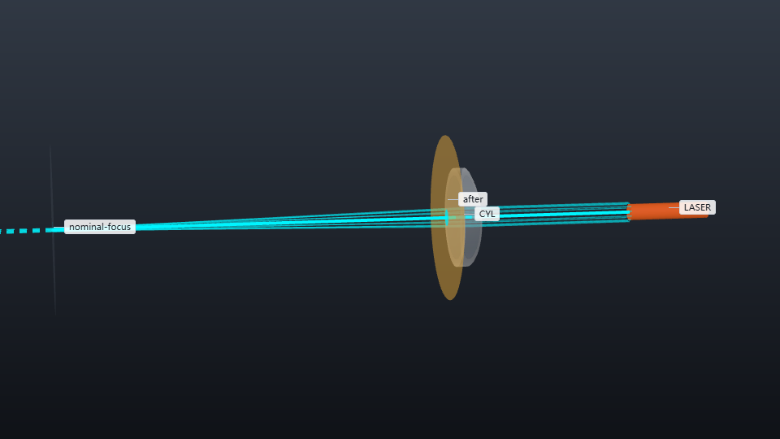

# 柱面光片的厚度与传播范围

柱面透镜只聚焦高斯光束的一个横向方向。缩短焦距会减小光片厚度，同时缩短有效传播范围。本案例通过真实双界面柱面处方和可分离的近轴高斯模型，比较这两个变化。



光源沿 +z 传播，波长为 488 nm，束腰半径为 1 mm，功率为 10 mW。透镜前顶点位于 z=20 mm；透镜厚 2 mm、折射率 n=1.52，入射面为曲面、出射面为平面。柱轴沿 x，因此聚焦方向为 y。默认入射面半径为 26 mm，通光直径为 10 mm，每个面的功率透射率为 0.995。折射率在 450–650 nm 范围内取常数，表面采用理想面形，M²=1。

| 透镜焦距 | 束腰处光片 FWHM 厚度 | 厚度不超过束腰值 sqrt(2) 倍的全范围 | 束腰 z 坐标 |
| --- | --- | --- | --- |
| 50 mm | 9.14456 um | 0.776659 mm | 70.6824 mm |
| 40 mm | 7.31569 um | 0.497068 mm | 60.6834 mm |
| 65 mm | 11.88777 um | 1.312519 mm | 85.6796 mm |

三个方案输出功率均为 9.90025 mW。默认焦点处的宽轴 FWHM 为 1.17748 mm。40 mm 透镜使束腰厚度减小约 20%，传播范围缩短约 36%。本例目标为束腰厚度不超过 10 um、全范围不小于 0.45 mm；40 和 50 mm 方案均满足；65 mm 方案的传播范围更长，但厚度未达标，流程退出码为 1。

## 运行与参数调整

在本案例目录中使用 Python 3.12 或更高版本，安装固定版本依赖后运行：

```bash
python -m pip install -r requirements-light-sheet.txt
os-optics project run project.json --out-dir ../sheet-native
os-optics results targets ../sheet-native
python workflow.py --out ../sheet-default
python workflow.py --focal-length-mm 40 --out ../sheet-f40
python workflow.py --focal-length-mm 65 --out ../sheet-f65
python workflow.py --out ../sheet-default --plot-only
```

在已检查的 Windows/Python 3.14 环境中，默认完整流程约需 4–5 秒，包含预览绘制；物理配置构建与计算约需 2 秒。`--focal-length-mm` 接受 25–110 mm，`--input-waist-mm` 接受 0.5–1.5 mm。改变焦距时，流程根据曲面参数重新构造柱面处方。缩短焦距或增大入射束腰，会减小光片厚度和传播范围；引擎逐项评估两个目标。流程退出码 1 表示至少一个示例阈值未满足。

## 读取保存的结果

引擎计算双界面折射、两轴高斯 q 参数和功率。z=23 mm 观测面的交接数据保存在 `handoff.json`，原生目标评估保存在 `targets.json`。外部脚本由这些数据计算 FWHM = sqrt(2 ln 2) w0、全范围 = 2 zR，其中 w0 是薄轴的 1/e² 强度半径。这里的范围指厚度不超过束腰厚度 sqrt(2) 倍的区间，与固定的 10 um 束腰厚度目标分别定义。

`profiles.npz` 保存以 mm 为单位的 z、y 坐标和两轴 1/e² 半径，x=0 纵截面强度的单位为 W/mm²，束腰面沿 x 积分后的强度单位为 W/mm。这些曲线由原生 q 和功率代入可分离 TEM00 公式得到。`preview.png` 显示纵截面和厚度曲线。`configuration.json` 保存物理输入，与绘图设置分开；`--plot-only` 仅读取已有数据，不进行仿真。`run/project.json` 是该参数样本经引擎规范化后的配置。

独立 ABCD 计算依次完成 q 在入射面折射、玻璃内传播、出射面折射和到观测面的传播。三个方案中两轴 q 与引擎的相对误差均小于 2e-16。流程还检查 0.995² 的功率透射率，并对束腰边缘分布进行数值积分。外部检查保存在 `metrics.json`，与引擎目标评估分开。所有生成文件均写入指定的输出目录。

## 从保存结果制作展示素材

使用 kit 0.4.0、Chrome/Chromium，中文绘图需微软雅黑或 Noto Sans CJK SC 字体。
输入为已完成的 `workflow.py` 结果目录。首个输入提供参考纵截面和系统视图；
加入 65 mm 结果可比较超过束腰厚度上限的设计。

```bash
python present_case.py ../sheet-default ../sheet-f40 --out ../sheet-talk-en --language en --background light --size 1920x1080 --bundle ../sheet-talk-en.zip
python present_case.py ../sheet-default ../sheet-f40 ../sheet-f65 --out ../sheet-talk-zh --language zh-CN --background dark --size 1920x1080 --bundle ../sheet-talk-zh.zip
```

打开 `index.html` 查看柱面透镜视图、半径与范围目标对比、纵向强度分布及 FWHM
曲线。分布与曲线由保存的高斯 q 参数和功率计算。圆点标记 ±zR，图例给出束腰
FWHM 和全范围；目标图展示 1/e² 束腰半径与瑞利长度。图旁提供 PNG/SVG、双语
说明、数值快照和溯源记录。

辅助脚本读取保存结果。每种语言、背景或尺寸使用新的输出目录。使用
`present_case.py` 和保存的运行目录重建完整图库。`presentation.json` 对应原生
目标对比图；对它运行 `present build` 会将图库索引替换为这张图。相机设置、
数据来源、单位与输入哈希保存在图件记录中。

ZIP 包含离线图库和外部高斯分布快照。解压后运行：

```bash
python sheet-talk-en/assets/profiles/present_case.py --redraw-external sheet-talk-en/assets/profiles/case-redraw.json --out ../sheet-profiles-restyled --language zh-CN --background dark --size 1920x1080
```

该命令使用包内数据重绘分布图及其图库。重建全部三张卡片需要保存的运行目录和
上面的完整图库命令；迁移后传入新目录位置。
