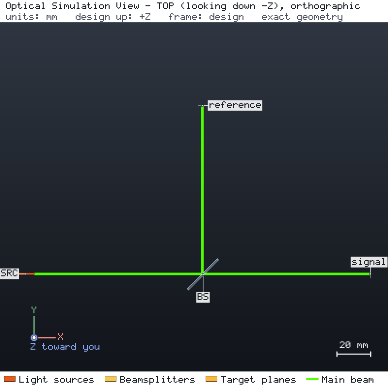

# Detector linearity and reference-channel normalization

A 1 mW, 532 nm laser beam is split 50:50 by a plate beam splitter. The transmitted half reaches the signal detector,
the reflected half the reference detector; both detectors have a 2.5 mm radius active area. The engine run confirms
the power on each detector and that the beam fits the active area. Two synthetic data sets then calibrate the
signal detector and remove slow source drift with the reference channel.



## Run it

```bash
os-optics-kit cases copy detector-measurements --dest .
cd detector-measurements
os-optics project run project.json --out-dir run
os-optics-kit measurements data/detector_response.csv --x input_power_mW --signal signal_V \
  --background dark_V --x-unit mW --signal-unit V --maximum-rmse 0.003 --out detector
```

## Results

| Target | Value | Bound | Assessment |
| --- | --- | --- | --- |
| `signal_power` | 0.5 mW | 0.5 mW ± 1 % | MET |
| `reference_power` | 0.5 mW | 0.5 mW ± 1 % | MET |
| `signal_beam_radius` | 0.5046 mm | ≤ 1 mm | MET |
| `reference_beam_radius` | 0.5046 mm | ≤ 1 mm | MET |

| Data | Rows used | Fitted response |
| --- | --- | --- |
| `data/detector_response.csv` (dark-subtracted signal vs incident power) | 7 of 10 | 2 V/mW · P + 0.005 V, RMSE 0.002 V |
| `data/reference_drift.csv` (signal / reference, both dark-subtracted, over 7 s) | 8 of 13 | 0.4, constant, RMSE 0 |

Both channels drift by 7 % over the scan; their ratio does not. Rows with a missing or invalid reading or a
non-positive dark-subtracted reference are excluded and listed in `processed.csv`; the analyses report WARNING for the exclusions and PASS for the
RMSE targets. `data/README.md` gives the formulas behind the data and their attribution. Verified with
os-optics 0.12.0; run status PASS.
