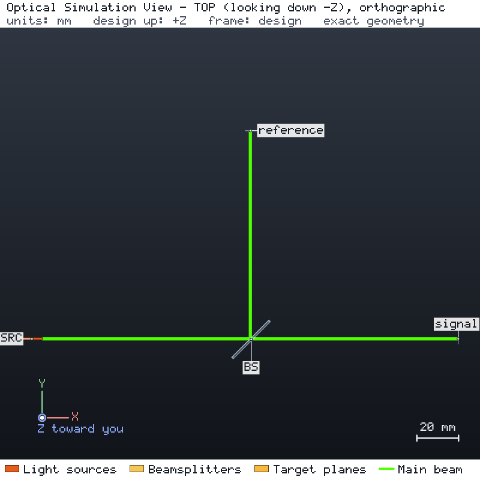

# 探测器线性度与参考通道归一化

1 mW、532 nm 的激光束由平板分束镜按 50:50 分开：透射光到达信号探测器，反射光到达参考探测器；两个探测器的有效区域
半径均为 2.5 mm。引擎运行确认每个探测器上的功率，并确认光束落在有效区域之内。随后用两组合成数据标定信号探测器，
并借助参考通道消除光源的缓慢漂移。



## 运行

```bash
os-optics-kit cases copy detector-measurements --dest .
cd detector-measurements
os-optics project run project.json --out-dir run
os-optics-kit measurements data/detector_response.csv --x input_power_mW --signal signal_V \
  --background dark_V --x-unit mW --signal-unit V --maximum-rmse 0.003 --out detector
```

## 结果

| 目标 | 数值 | 界限 | 评估 |
| --- | --- | --- | --- |
| `signal_power` | 0.5 mW | 0.5 mW ± 1 % | MET |
| `reference_power` | 0.5 mW | 0.5 mW ± 1 % | MET |
| `signal_beam_radius` | 0.5046 mm | ≤ 1 mm | MET |
| `reference_beam_radius` | 0.5046 mm | ≤ 1 mm | MET |

| 数据 | 使用行数 | 拟合响应 |
| --- | --- | --- |
| `data/detector_response.csv`（扣除暗读数的信号对入射功率） | 10 行中 7 行 | 2 V/mW · P + 0.005 V，RMSE 0.002 V |
| `data/reference_drift.csv`（信号 / 参考，均扣除暗读数，7 s 内） | 13 行中 8 行 | 0.4，恒定，RMSE 0 |

两个通道在扫描期间都漂移了 7 %，二者之比保持不变。读数缺失或无效、或扣除暗读数后参考值非正的行被排除，并列在 `processed.csv` 中；
两项分析因排除行而报告 WARNING，RMSE 目标为 PASS。`data/README.md` 给出数据的构造公式与来源说明。
已用 os-optics 0.12.0 验证；运行状态 PASS。
