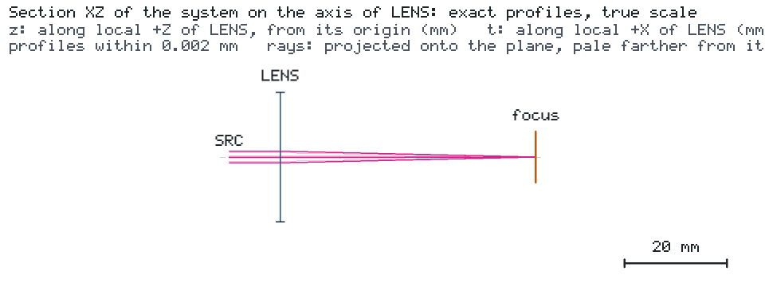

# A focusing requirement verified at a fixed working plane

[简体中文](README.zh-CN.md) · [Requirement and agent sheet](CASE.md)

**Requirement:** focus a 780 nm Gaussian beam to a 1/e² intensity **radius ≤20 µm at a fixed work plane**,
50 mm beyond the nominal lens position, then determine how much axial lens-placement error is allowed.
This case carries that requirement through a design, an unmet starting placement, a correction, target
assessment, a refined sweep, comparison and a deliverable report.



## Quantified design

| Quantity | Value and convention |
| --- | --- |
| Source | 780 nm, 1 mW, M²=1; 1 mm Gaussian 1/e² intensity waist radius at x=−10 mm |
| Lens | Native ideal thin lens, f=50 mm, 25.4 mm clear diameter, nominal x=0 |
| Work plane | `focus`, fixed x=50 mm, 5 mm active radius |
| Native target | `spot_radius`, `beam_radius_mm` ≤0.020 mm at `focus` |
| Placement error | Lens translation along design +x; source, detector and target stay fixed |
| Baseline sweep | −1 to +1 mm in 0.2 mm steps; each passing/failing transition refined to ≤0.01 mm |

The radius is measured at the fixed physical plane. The target does not request a minimum waist or a waist
location. Its nominal value is about 12.414 µm. A +1 mm misplaced lens misses the radius requirement;
returning it to x=0 meets it. Every placement sample is a full Engine run through Kit's sweep helper.
An independent complex-q calculation propagates from the unchanged source to the moved lens and then to
the unchanged detector, checking every computed radius.

## Run the complete workflow

```bash
python -m pip install "os-optics[protected]==0.13.0" "os-optics-kit[plot]"
os-optics-kit cases copy focus-requirement --dest .
cd focus-requirement
os-optics-kit cases verify focus-requirement
python workflow.py all --out output
os-optics-kit summary output/nominal/run
```

The three stages share the same steps used by `all`:

```bash
python workflow.py compute --out finer
python workflow.py study --out finer --resolution-mm 0.005
python workflow.py present --out finer --dest finer-zh-dark --language zh-CN --background dark
```

Use a new output directory for a new computation. `compute` creates nominal and +1 mm runs. `study` reuses
the saved Project, performs the coarse and refined sweeps, checks the reference, and writes the comparison
and reports. `present` reads saved results only and uses Kit's native target/sweep plots, offline gallery
and bundle. Both languages and light/dark backgrounds are available; it never moves optics or reruns them.
For a single manual variation, use `os-optics-kit edit project.json --describe --ids LENS`, then a `transform`
of `LENS` along design x while leaving observation `focus` unchanged.

## The placement answer

The default refined grid gives a sampled passing interval **[−0.77, +0.79] mm**. The lower boundary is
bracketed by −0.78 mm (UNMET) and −0.77 mm (MET); the upper by +0.79 mm (MET) and +0.80 mm (UNMET).
Each bracket is at most 0.01 mm wide. This is a sampled axial-placement answer for the declared source and
ideal lens. The saved [numerical snapshot](data/snapshot.json) records the exact run values and reference
error. `verification.json` records the interval generated by the selected refinement resolution.

The source-to-lens and lens-to-detector distances change in opposite directions, so the two limits need
not be symmetric. All passing and failing samples remain in the tables. The target stays at 20 µm;
the sweep never follows a moved focus with a moved detector.

## Deliverables

`nominal/` and `before/` contain Project/run/target records. `placement/` and `refinement/` hold specifications,
sample Projects and runs, `table.csv` and `summary.json`. `comparison/` contains the native before/after
comparison. `verification.json` contains the requirement, fixed coordinates, interval, two boundary brackets,
resolution, evaluation count and maximum reference error. `report-en/` and `report-zh-CN/` add the requirement
answer to Kit's factual report, including input/result identities and artifact hashes.

Open `presentation/index.html` offline or extract `presentation.zip` anywhere. The bundle contains PNG/SVG/PDF
plots, exact plot data, bilingual captions and provenance. It is an asset handoff; keep the output tree and
case script together for saved-data redraw after moving them. The native ideal-lens model and this case's
prescription/code are catalog-free and MIT-licensed.
