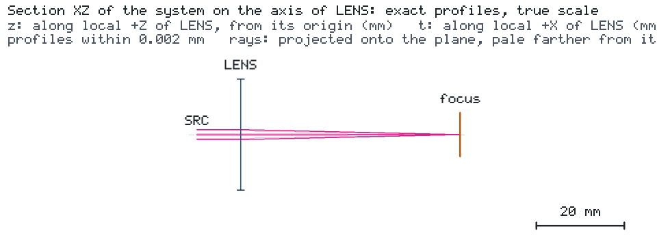

# 固定工作面聚焦要求的完整验证

[English](README.md) · [要求与智能体说明](CASE.md)

**要求：** 将 780 nm 高斯光束聚焦到固定工作面，使其 1/e² 强度**半径≤20 µm**。该平面位于透镜标称位置后方
50 mm，并求透镜允许的轴向位置误差。本例把要求依次转成设计、未满足的初始位置、位置修正、目标评估、加密扫描、
比较及可交付报告。



## 量化设计

| 量 | 数值与定义 |
| --- | --- |
| 光源 | 780 nm、1 mW、M²=1；x=−10 mm 处的高斯 1/e² 强度束腰半径为 1 mm |
| 透镜 | 原生理想薄透镜，f=50 mm，通光直径 25.4 mm，标称 x=0 |
| 工作面 | `focus`，固定 x=50 mm，有效半径 5 mm |
| 原生目标 | `spot_radius`，`focus` 处的 `beam_radius_mm`≤0.020 mm |
| 位置误差 | 透镜沿设计坐标 +x 平移；光源、探测面及目标保持不动 |
| 基线扫描 | −1 至 +1 mm，步长 0.2 mm；通过/失败的两个交界分别加密到≤0.01 mm |

目标半径在固定物理平面上测量，不是最小束腰，也不是束腰位置。标称半径约为 12.414 µm。
透镜偏移 +1 mm 时不满足要求，恢复至 x=0 后满足。每个位置样本都通过 Kit 扫描工具执行完整引擎计算。
独立复 q 参数计算从不动的光源传播至移动的透镜，再传播至不动的探测面，逐点核对半径。

## 完整运行

```bash
python -m pip install "os-optics[protected]==0.13.0" "os-optics-kit[plot]"
os-optics-kit cases copy focus-requirement --dest .
cd focus-requirement
os-optics-kit cases verify focus-requirement
python workflow.py all --out output
os-optics-kit summary output/nominal/run
```

三个独立阶段与 `all` 共用步骤：

```bash
python workflow.py compute --out finer
python workflow.py study --out finer --resolution-mm 0.005
python workflow.py report --out finer
python workflow.py present --out finer --dest finer-zh-dark --language zh-CN --background dark
```

新计算使用新输出目录。`compute` 创建标称和 +1 mm 运行；`study` 使用保存的 Project 执行粗扫、加密、参考核对，
并生成比较与报告；`report` 从保存结果刷新案例表格；`present` 仅读取已保存结果，使用 Kit 原生目标/扫描图、离线图库及打包功能。
支持两种语言和明暗背景；重绘不移动光学元件、不重新仿真。手动单次变化可先执行
`os-optics-kit edit project.json --describe --ids LENS`，再沿设计 x 对 `LENS` 做 `transform`，
保持观测面 `focus` 不变。

## 位置公差答案

默认加密网格给出的采样通过区间为 **[−0.77, +0.79] mm**。下边界由 −0.78 mm（UNMET）与 −0.77 mm（MET）
夹逼，上边界由 +0.79 mm（MET）与 +0.80 mm（UNMET）夹逼。每个区间宽度至多 0.01 mm。
这是针对声明光源及理想透镜的采样轴向位置答案。[数值快照](data/snapshot.json)记录运行数值与参考误差；
输出中的 `verification.json` 记录所选加密分辨率实际产生的区间。

光源到透镜、透镜到探测面的距离朝相反方向变化，因而上下限不必对称。表中保留全部通过与失败样本。
目标始终为 20 µm；扫描时不移动探测面去追随焦点。

## 交付物

`nominal/`、`before/` 包含 Project、运行和目标记录。`placement/`、`refinement/` 保存规格、样本 Project 和运行、
`table.csv`、`summary.json`。`comparison/` 包含原生前后比较。`verification.json` 包含要求、固定坐标、区间、
两个边界夹逼、分辨率、评估次数和最大参考误差。`report-en/`、`report-zh-CN/` 在 Kit 事实报告中加入要求答案，
并记录输入/结果身份和产物哈希。

离线打开 `presentation/index.html`，或把 `presentation.zip` 解压到任意位置。包中含 PNG/SVG/PDF 图件、
准确绘图数据、双语图注及来源记录。它是图件交付包；若需移动后从既有数据重绘，请同时保留输出树和案例脚本。
原生理想薄透镜模型及本例的处方、代码不依赖目录，案例采用 MIT 许可。
