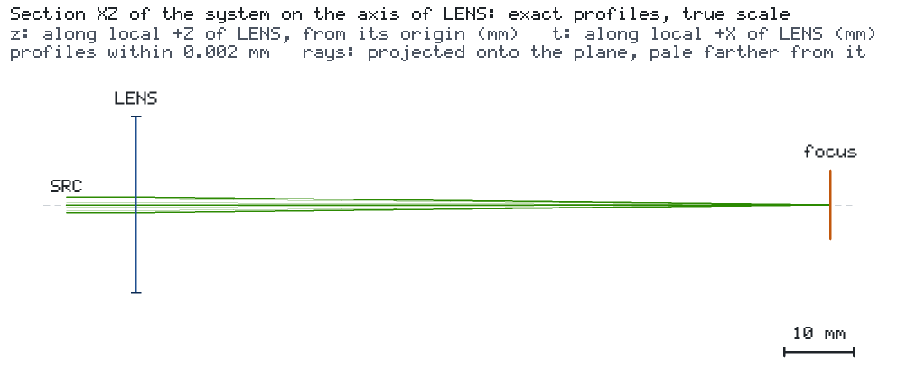

# Gaussian focus of an ideal thin lens

English · [简体中文](README.zh-CN.md)

A 532 nm laser beam with a 1 mm waist radius passes an ideal thin lens with a 100 mm focal length. The observation
plane `focus` sits in the back focal plane, and the target `spot_radius` asks for a 1/e² beam radius of at most
50 µm. No catalog is needed: the lens is the engine's native ideal thin lens.




## Run it

```bash
os-optics-kit cases copy ideal-lens-focus --dest .
cd ideal-lens-focus
os-optics project run project.json --out-dir run
os-optics results targets run
os-optics view run
```

## Results

| Target | Value | Bound | Assessment |
| --- | --- | --- | --- |
| `spot_radius` | 0.01693 mm | ≤ 0.05 mm | MET |

The value is the Gaussian focus w' = λf / (πw) = 16.93 µm. Verified with os-optics 0.13.0; run status PASS.

`python ideal_lens_focus.py --out run-api` builds the same design with the engine's request API and exports the
arrivals as CSV; `--maximum-radius-mm 0.001` shows an unmet target (FAIL, exit code 1).
