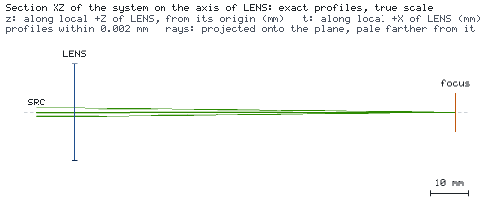

# 理想薄透镜的高斯聚焦

[English](README.md) · 简体中文

波长 532 nm、束腰半径 1 mm 的激光束经过焦距 100 mm 的理想薄透镜。观测面 `focus` 位于后焦面，目标
`spot_radius` 要求 1/e² 光束半径不超过 50 µm。无需目录：透镜是引擎的原生理想薄透镜。




## 运行

```bash
os-optics-kit cases copy ideal-lens-focus --dest .
cd ideal-lens-focus
os-optics project run project.json --out-dir run
os-optics results targets run
os-optics view run
```

## 结果

| 目标 | 数值 | 界限 | 评估 |
| --- | --- | --- | --- |
| `spot_radius` | 0.01693 mm | ≤ 0.05 mm | MET |

该值即高斯聚焦公式 w' = λf / (πw) = 16.93 µm。已用 os-optics 0.13.0 验证；运行状态 PASS。

`python ideal_lens_focus.py --out run-api` 用引擎的请求 API 构建同一设计并把到达数据导出为 CSV；
`--maximum-radius-mm 0.001` 演示未满足的目标（FAIL，退出码 1）。
