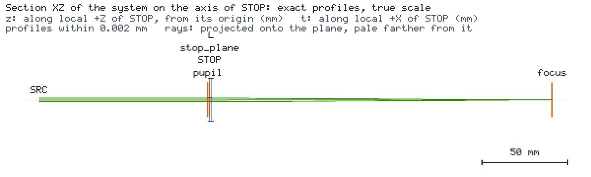
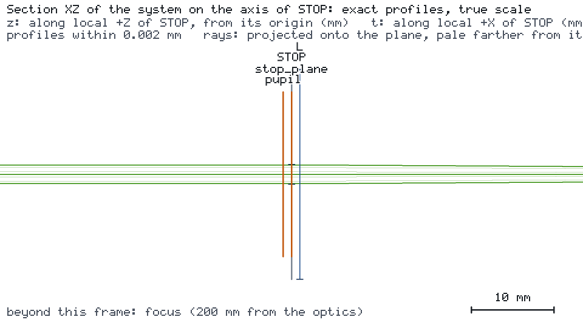

# Diffraction at a declared stop

A 532 nm TEM00 beam (1 mm waist radius, 1 mW) passes a circular aperture stop and an ideal thin lens with a 200 mm
focal length. What is the irradiance in the back focal plane? The engine traces the Gaussian beam and the power the
stop transmits; after a truncating stop the focal field needs a diffraction calculation. The engine hands the beam
state at the stop to external diffraction codes.





## Run it

```bash
os-optics-kit cases copy interop-diffraction --dest .
cd interop-diffraction
python -m pip install -r requirements-diffraction.txt
python opensci_handoff.py --out diff
python external_focus.py diff
```

## Results

| Target (1.2 mm stop) | Value | Bound | Assessment |
| --- | --- | --- | --- |
| `spot` | 0.03387 mm | ≤ 0.1 mm | MET (run status WARNING, `GAUSSIAN_TRUNCATION`) |

| Stop radius | Engine status | Engine Gaussian focal peak vs diffraction reference |
| --- | --- | --- |
| 3 mm | PASS | +0.024 % |
| 1.2 mm (5.6 % of the power blocked) | WARNING | +62 % |
| 0.5 mm | OUT_OF_MODEL_SCOPE | no Gaussian result |

The transmitted power is exact in every case. Without truncation the engine's focal peak matches the diffraction
result; after a `GAUSSIAN_TRUNCATION` warning only the power is reliable and the focal irradiance comes from the
external calculation. LightPipes converges to the Hankel-integral reference within 1e-3 on all three stops, prysm and
POPPY reproduce its profile to 4e-7 and Diffractio its peak to 3e-5. Verified with os-optics 0.12.0 on Python 3.14.7
and, for Diffractio, Python 3.12.14.
