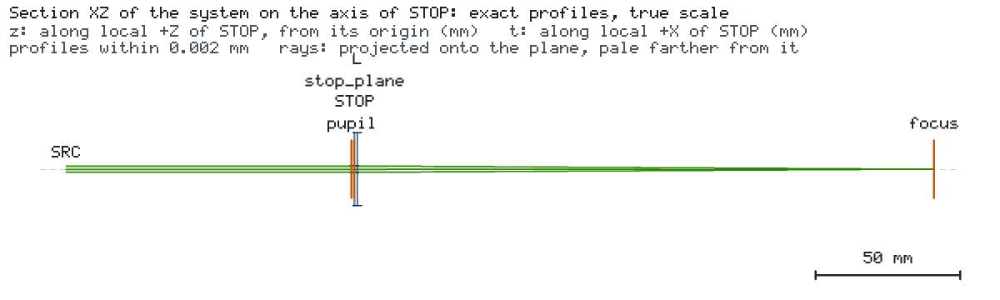
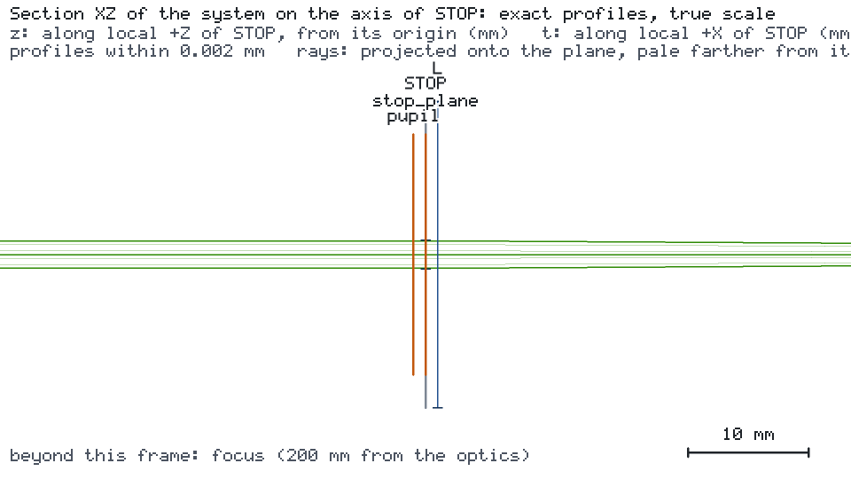

# 声明光阑处的衍射

波长 532 nm 的 TEM00 光束（束腰半径 1 mm，1 mW）通过圆形孔径光阑与焦距 200 mm 的理想薄透镜。后焦面上的辐照度是多少？
引擎追迹高斯光束及光阑透过的功率；光阑截断光束后，焦面场需要衍射计算。引擎把光阑处的光束状态交给外部衍射程序。





## 运行

```bash
os-optics-kit cases copy interop-diffraction --dest .
cd interop-diffraction
python -m pip install -r requirements-diffraction.txt
python opensci_handoff.py --out diff
python external_focus.py diff
```

## 结果

| 目标（1.2 mm 光阑） | 数值 | 界限 | 评估 |
| --- | --- | --- | --- |
| `spot` | 0.03387 mm | ≤ 0.1 mm | MET（运行状态 WARNING，`GAUSSIAN_TRUNCATION`） |

| 光阑半径 | 引擎状态 | 引擎高斯焦点峰值相对衍射参考值 |
| --- | --- | --- |
| 3 mm | PASS | +0.024 % |
| 1.2 mm（遮挡 5.6 % 的功率） | WARNING | +62 % |
| 0.5 mm | OUT_OF_MODEL_SCOPE | 不给出高斯结果 |

各情形下的透过功率都是精确的。无截断时引擎的焦点峰值与衍射结果一致；出现 `GAUSSIAN_TRUNCATION` 警告后只有功率可靠，
焦面辐照度由外部计算给出。LightPipes 在三个光阑上都收敛到 Hankel 积分参考值的 1e-3 以内，prysm 与 POPPY 以 4e-7
复现其轮廓，Diffractio 以 3e-5 复现峰值。已在 Python 3.14.7 上用 os-optics 0.13.0 验证，Diffractio 部分在
Python 3.12.14 上验证。
