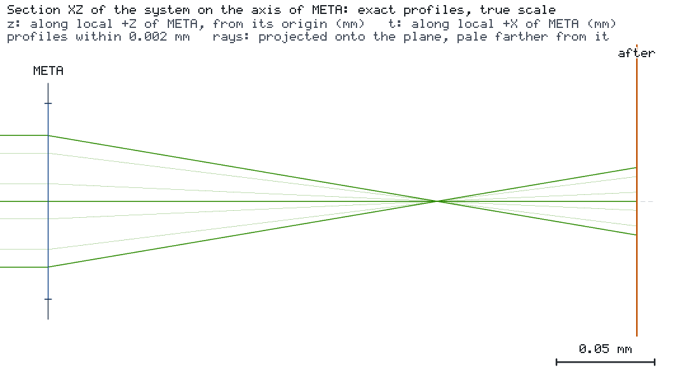

# Metasurface lens as a virtual component

A TiO2 nanopillar metalens (focal length 200 µm at 532 nm, 100 µm diameter) is characterized outside the engine and
turned into an engine model. RCWA (grcwa) gives every pillar's transmission, an angular-spectrum calculation gives the
focus, and a fit turns the focus table into a `TABULATED_THIN_LENS` with stated errors and a validated domain. The
engine then uses the model like any other lens and refuses to report results outside its domain as valid.



## Run it

```bash
os-optics-kit cases copy interop-metasurface --dest .
cd interop-metasurface
os-optics project run project.json --out-dir run
python -m pip install -r requirements-metasurface.txt
python step1_unit_cells.py --out ms
```

`CASE.md` lists all seven commands of steps 1–4 (24 minutes in the verified run).

## Results

| Target | Value | Bound | Assessment |
| --- | --- | --- | --- |
| `spot` | 1.126 µm | ≤ 10 µm | MET (run status WARNING: the aperture clips 0.4 % of the beam) |

| Model property | Value |
| --- | --- |
| Rows | 10 wavelengths, 490–580 nm |
| Stated errors | focus position ± 1.4 µm, spot radius ± 8.1 %, power ± 19 % |
| Domain | field angle ≤ 2°, beam radius ≤ 30 µm, x polarization |
| Engine vs the model's own thin-lens prediction | 4e-16 relative |
| Held-out test cases (wavelengths, 25 µm beam, 1.5°) | all inside the stated errors |
| 450 nm, 5°, 8°, 20°, an unvalidated metric | OUT_OF_MODEL_SCOPE, target INDETERMINATE |

The model is a simulation model of this metalens, not an orderable product. Verified with os-optics 0.13.0 on
Python 3.14.7 (grcwa 0.1.2, numpy 2.5.4, scipy 1.18.1).
