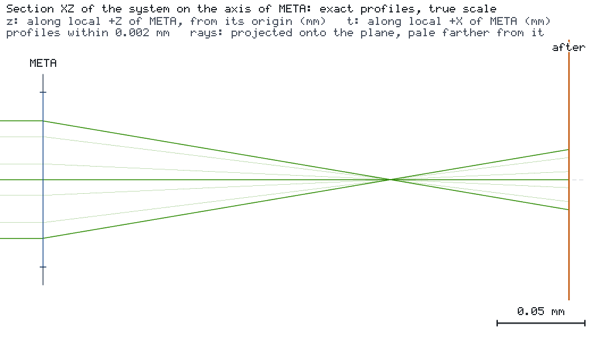

# 作为虚拟元件的超表面透镜

[English](README.md) · [智能体案例说明](CASE.md)

TiO2 纳米柱超透镜（532 nm 处焦距 200 µm，直径 100 µm）先在引擎之外完成表征，再转换为引擎模型。RCWA（grcwa）给出每根
纳米柱的透射，角谱计算给出焦点，拟合把焦点表转换为带有声明误差与验证域的 `TABULATED_THIN_LENS`。随后引擎像使用其他
透镜一样使用该模型，并拒绝把验证域之外的结果报告为有效。




两幅图都是引擎对 `project.json` 一次运行的无浏览器快照：`os-optics view run --no-browser --snapshot DIR` 加 `--camera 30,20 --size 960x540` 运行一次，再加 `--section ALL --size 1200x600` 运行一次。
在 kit 检出目录中，`os-optics-kit cases images interop-metasurface` 会按 `images.json` 中的记录原样重新渲染这些视图。

## 运行

```bash
os-optics-kit cases copy interop-metasurface --dest .
cd interop-metasurface
os-optics project run project.json --out-dir run
os-optics results targets run
python -m pip install -r requirements-metasurface.txt
python step1_unit_cells.py --out ms
```

`CASE.md` 列出步骤 1–4 的全部七条命令（总计约 24 分钟）。

## 结果

| 目标 | 数值 | 界限 | 评估 |
| --- | --- | --- | --- |
| `spot` | 1.126 µm | ≤ 10 µm | MET（运行状态 WARNING：孔径截去 0.4 % 的光束） |

| 模型属性 | 数值 |
| --- | --- |
| 数据行 | 10 个波长，490–580 nm |
| 声明误差 | 焦点位置 ± 1.4 µm，光斑半径 ± 8.1 %，功率 ± 19 % |
| 验证域 | 视场角 ≤ 2°，光束半径 ≤ 30 µm，x 偏振 |
| 引擎与模型自身薄透镜预测之差 | 相对 4e-16 |
| 留出的测试情形（波长、25 µm 光束、1.5°） | 全部在声明误差之内 |
| 450 nm、5°、8°、20°、未验证的指标 | OUT_OF_MODEL_SCOPE，目标 INDETERMINATE |

已在 Python 3.14.7 上用 os-optics 0.13.0 验证（grcwa 0.1.2、numpy 2.5.4、scipy 1.18.1）。
