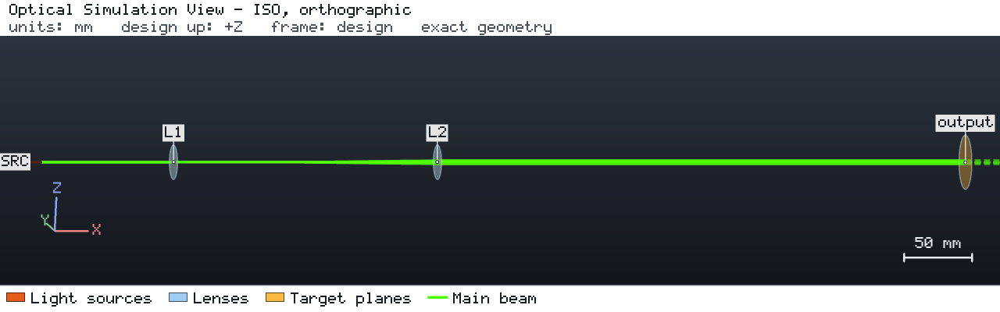
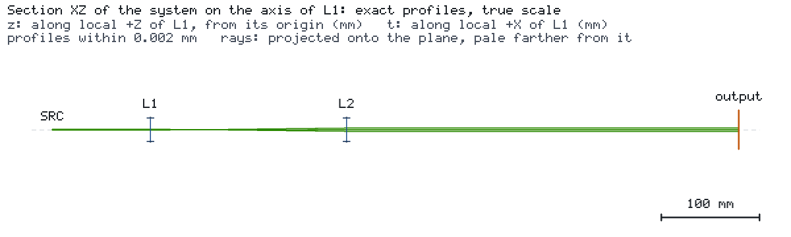

# External optimization and Sobol tolerance

[简体中文](README.zh-CN.md)

A Keplerian beam expander of two ideal thin lenses (f = 50 mm and 150 mm) expands a 532 nm beam with a 0.5 mm waist
radius. The optimizers SciPy and Optuna choose the position of L2; the engine computes each design and reports the
output divergence. SALib then estimates which mounting error matters most.





Both images are the engine's browser-free snapshots of a run of `project.json`:
`os-optics view run --no-browser --snapshot DIR` with `--views iso --size 1280x400`, and again with
`--section ALL --frame=scene --size 1200x420`. In a kit checkout,
`os-optics-kit cases images interop-optimization` re-renders exactly these views as recorded in `images.json`.

## Run it

```bash
os-optics-kit cases copy interop-optimization --dest .
cd interop-optimization
os-optics project run project.json --out-dir run
os-optics results targets run
python -m pip install -r requirements-optimization.txt
python optimize_expander.py --out opt
python optimize_expander.py --out opt-strict --max-divergence-rad 1e-9
```

## Results

| Target | Value | Bound | Assessment |
| --- | --- | --- | --- |
| `collimated` | 0.1129 mrad | ≤ 1 mrad | MET |

| Check (verified run, 710 engine evaluations) | Result | Tolerance |
| --- | --- | --- |
| SciPy optimum vs ABCD optimum (200.0573 mm separation) | 9e-7 mm | 1e-4 mm |
| Optuna best divergence above the optimum | 0.14 % | 1 % |
| Engine divergence vs ABCD reference, every evaluation | 2e-14 relative | 1e-9 |
| Engine vs reference total Sobol indices (L1, L2, waist) | 2e-14 | 1e-6 |

`evaluations.jsonl` keeps every evaluation with its inputs, status and run identity. A requirement no design can
meet (`--max-divergence-rad 1e-9`) ends with NO_FEASIBLE_RESULT, exit code 2. Verified with os-optics 0.13.0 on
Python 3.14.7 (SciPy 1.18.1, Optuna 5.0.0, SALib 1.6.0).
