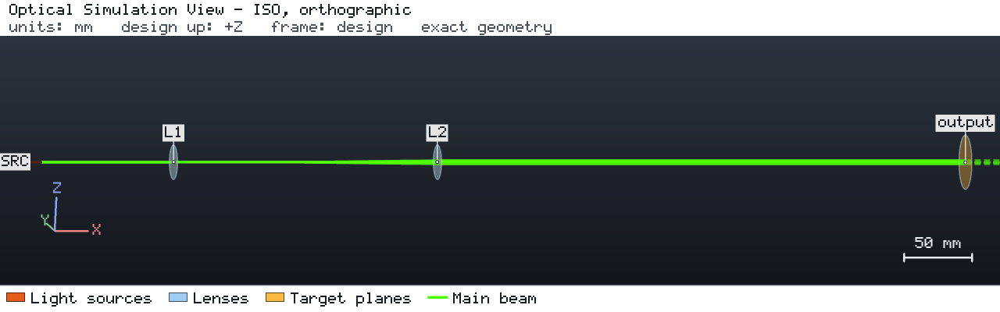
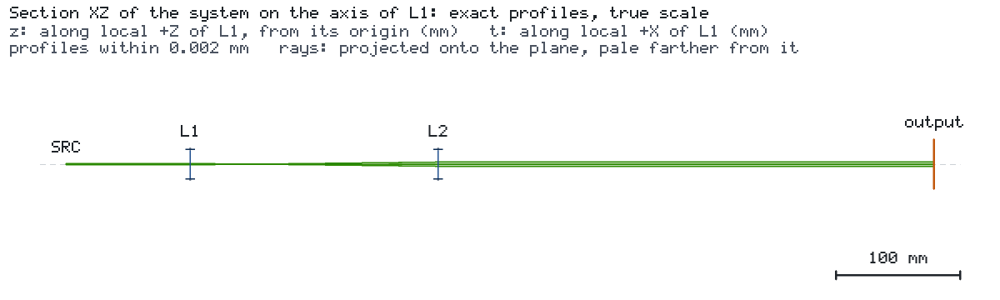

# 外部优化与 Sobol 公差分析

[English](README.md)

由两片理想薄透镜（f = 50 mm 与 150 mm）组成的开普勒扩束器扩展波长 532 nm、束腰半径 0.5 mm 的光束。优化器 SciPy 与
Optuna 选择 L2 的位置；引擎计算每个设计并给出输出发散角。随后 SALib 估计哪个装调误差影响最大。





两幅图都是引擎对 `project.json` 一次运行的无浏览器快照：`os-optics view run --no-browser --snapshot DIR` 加 `--views iso --size 1280x400` 运行一次，再加 `--section ALL --frame=scene --size 1200x420` 运行一次。
在 kit 检出目录中，`os-optics-kit cases images interop-optimization` 会按 `images.json` 中的记录原样重新渲染这些视图。

## 运行

```bash
os-optics-kit cases copy interop-optimization --dest .
cd interop-optimization
os-optics project run project.json --out-dir run
os-optics results targets run
python -m pip install -r requirements-optimization.txt
python optimize_expander.py --out opt
python optimize_expander.py --out opt-strict --max-divergence-rad 1e-9
```

## 结果

| 目标 | 数值 | 界限 | 评估 |
| --- | --- | --- | --- |
| `collimated` | 0.1129 mrad | ≤ 1 mrad | MET |

| 检查（已验证的运行，710 次引擎计算） | 结果 | 容差 |
| --- | --- | --- |
| SciPy 最优解与 ABCD 最优解（间距 200.0573 mm）之差 | 9e-7 mm | 1e-4 mm |
| Optuna 最佳发散角高出最优值 | 0.14 % | 1 % |
| 每次计算的引擎发散角与 ABCD 参考值之差 | 相对 2e-14 | 1e-9 |
| 引擎与参考的总 Sobol 指数（L1、L2、束腰）之差 | 2e-14 | 1e-6 |

`evaluations.jsonl` 记录每次计算的输入、状态与运行标识。任何设计都无法满足的要求（`--max-divergence-rad 1e-9`）以
NO_FEASIBLE_RESULT 结束，退出码 2。已在 Python 3.14.7 上用 os-optics 0.13.0 验证（SciPy 1.18.1、Optuna 5.0.0、
SALib 1.6.0）。
