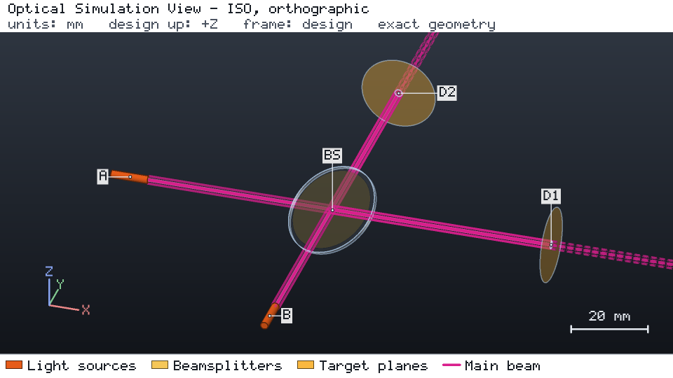
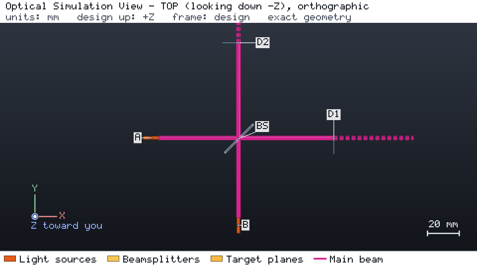

# Hong-Ou-Mandel interference from the linear optical network export

[简体中文](README.zh-CN.md)

Two 780 nm sources meet on a 50:50 plate beam splitter. The engine describes the layout as a linear optical network:
input and output modes, the transfer matrix, every path's group delay and the conventions. Quantum-optics simulators
compute photon statistics from that export; the Project's lasers only define modes, wavelength and polarization.





Both images are the engine's browser-free snapshots of a run of `project.json`:
`os-optics view run --no-browser --snapshot DIR` with `--views iso --size 960x540`, and again with
`--views top --size 960x540`. In a kit checkout, `os-optics-kit cases images interop-quantum` re-renders
exactly these views as recorded in `images.json`.

## Run it

```bash
os-optics-kit cases copy interop-quantum --dest .
cd interop-quantum
os-optics project run project.json --out-dir run
os-optics project network project.json --out hom.network.json
python -m pip install -r requirements-quantum.txt
python build_layouts.py --out q
python run_quantum.py q --inputs quantum_inputs.json
```

Licenses as reported upstream: perceval-quandela MIT, its required dependency exqalibur CC BY-NC-ND 4.0 (package
metadata), piquasso Apache-2.0.

## Results

| Target | Value | Bound | Assessment |
| --- | --- | --- | --- |
| `d1_power` | 1 mW | 1 mW ± 1 % | MET |
| `d2_power` | 1 mW | 1 mW ± 1 % | MET |

| Quantity (verified run) | Result |
| --- | --- |
| Perceval vs closed-form reference, all cases | 4e-8 |
| Piquasso vs closed-form reference, all cases | 2e-9 |
| HOM dip visibility over the ±0.3 mm delay scan | 0.9491 (reference 0.9491) |
| 3 mm window compensated by its phase delay only | indistinguishability 0.95 → 0.854 |
| 0.25 ps photons in the 1 mm Mach-Zehnder | refused: `SINGLE_FREQUENCY_MODEL_INVALID` |

The export's per-path group delay makes the window's 0.163 ps group-delay mismatch visible. Verified with
os-optics 0.13.0 on Python 3.14.7 (perceval-quandela 1.3.1, piquasso 8.0.1).
