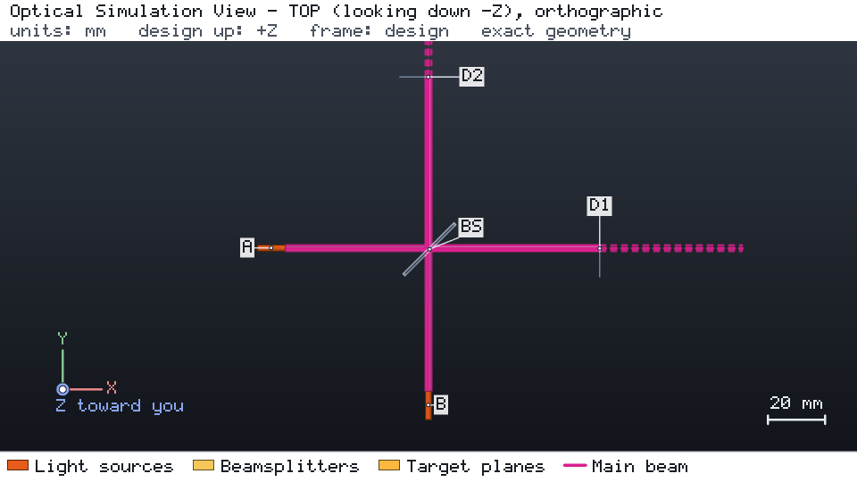

# 基于网络导出的 Hong-Ou-Mandel 干涉

两个 780 nm 光源在 50:50 平板分束镜上相遇。引擎把光路描述为线性光学网络：输入与输出模式、传输矩阵、每条路径的群延迟以及
约定。量子光学模拟器根据该导出计算光子统计；项目中的激光器只定义模式、波长与偏振。



## 运行

```bash
os-optics-kit cases copy interop-quantum --dest .
cd interop-quantum
python -m pip install -r requirements-quantum.txt
python build_layouts.py --out q
python run_quantum.py q --inputs quantum_inputs.json
```

## 结果

| 目标 | 数值 | 界限 | 评估 |
| --- | --- | --- | --- |
| `d1_power` | 1 mW | 1 mW ± 1 % | MET |
| `d2_power` | 1 mW | 1 mW ± 1 % | MET |

| 量（已验证的运行） | 结果 |
| --- | --- |
| Perceval 与闭式参考值之差，全部情形 | 4e-8 |
| Piquasso 与闭式参考值之差，全部情形 | 2e-9 |
| ±0.3 mm 延迟扫描中的 HOM 凹陷可见度 | 0.9491（参考值 0.9491） |
| 仅按相位延迟补偿的 3 mm 窗口 | 不可区分度 0.95 → 0.854 |
| 1 mm 马赫-曾德尔干涉仪中的 0.25 ps 光子 | 拒绝：`SINGLE_FREQUENCY_MODEL_INVALID` |

导出中每条路径的群延迟使窗口 0.163 ps 的群延迟失配可见。已在 Python 3.14.7 上用 os-optics 0.12.0 验证
（perceval-quandela 1.3.1、piquasso 8.0.1）。
