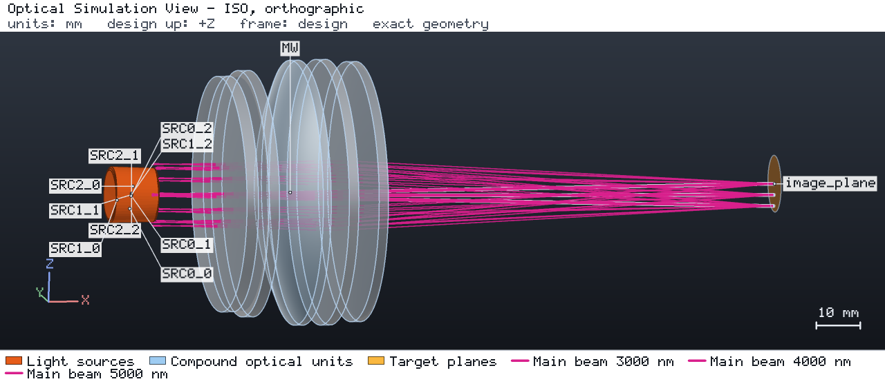
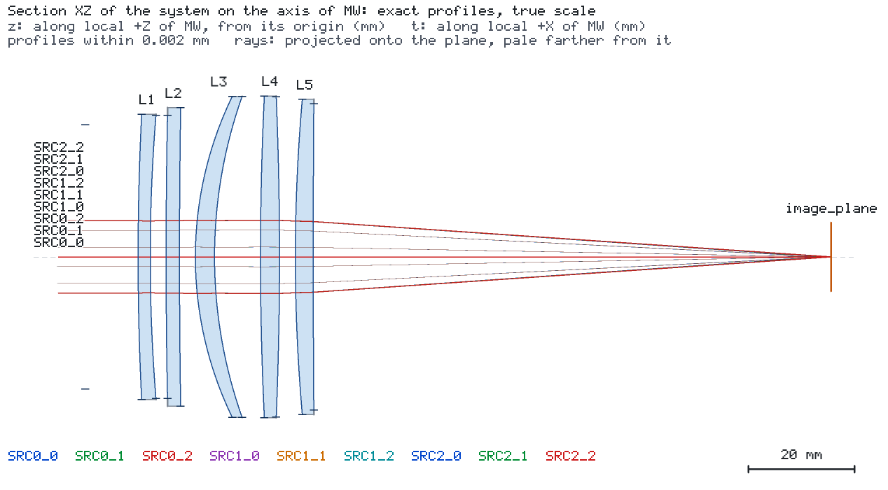
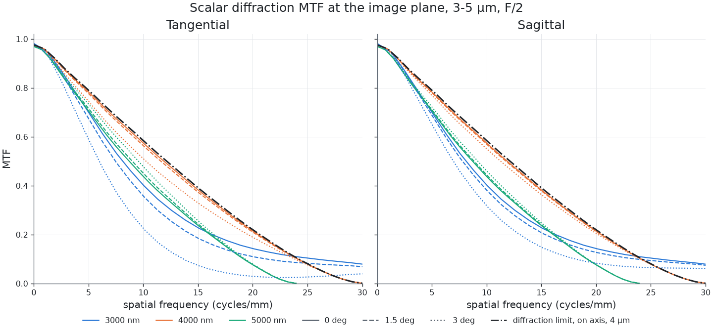
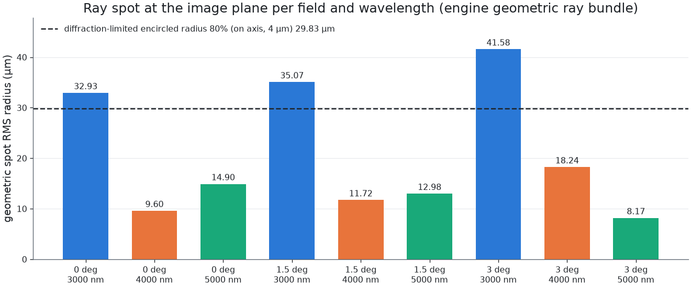
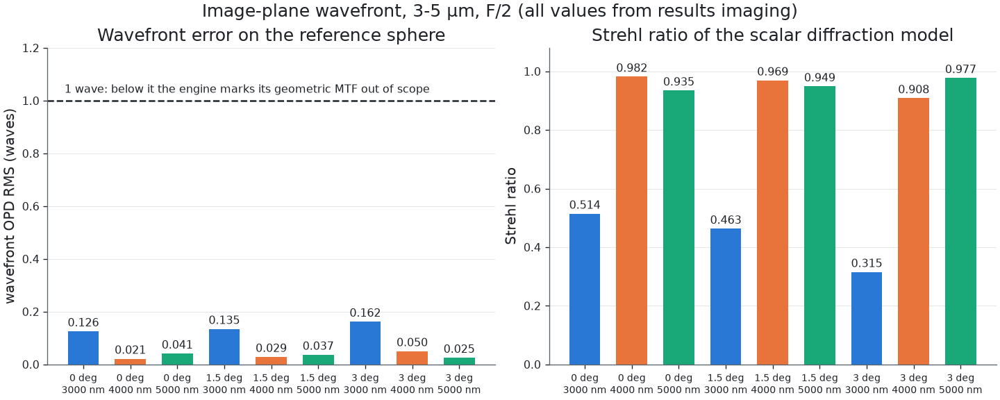

# A five-element 3-5 µm imager with manufacturable element thicknesses

[简体中文](README.zh-CN.md) · [Agent case sheet](CASE.md)

A refractive imager for the mid-wave infrared band: five elements of Si, ZnSe, CaF2, Si and ZnSe,
F/2, EFL 100 mm, half field 3°, evaluated at 3, 4 and 5 µm. The point of the case is the pair of
constraints the engine makes visible at once: the design is held to thicknesses a grinding shop can
produce, and the resulting image quality is reported by the engine's **scalar diffraction** model
rather than by ray spread.



## The design



The stop sits ahead of the first element with a 25 mm semi-diameter (50 mm across), which sets F/2
for a 100 mm focal length. Every glass element is held to a 2-12 mm centre thickness and a 1.5-3 mm edge thickness, and
every air gap stays positive at the rim:

| element | material | clear radius | centre thickness | edge thickness |
| --- | --- | --- | --- | --- |
| L1 | Si | 26.80 mm | 2.29 mm | 2.71 mm |
| L2 | ZnSe | 26.79 mm | 2.54 mm | 2.46 mm |
| L3 | CaF2 | 30.32 mm | 3.62 mm | 1.87 mm |
| L4 | Si | 30.25 mm | 3.59 mm | 2.25 mm |
| L5 | ZnSe | 28.93 mm | 3.37 mm | 2.25 mm |

## What the engine reports

The nine beams (three fields by three wavelengths) all reach the image plane, the run is in model
scope, and no beam is partly intercepted by the stop. The engine's diffraction model accepts every
one of them:

| quantity | value |
| --- | --- |
| `launch_radius_beam_radii` | 1.0 |
| `image_space_na` | 0.060 |
| diffraction MTF (on axis, 4 µm, 10.3 cycles/mm) | 0.561 |
| diffraction limit at the same frequency | 0.571 |
| Strehl ratio, 4 and 5 µm, all fields | 0.908-0.982 |
| Strehl ratio, 3 µm, all fields | 0.315-0.514 |
| ray spot RMS radius, 4 µm and 5 µm | 8.2-18.2 µm |
| ray spot RMS radius, 3 µm | 32.9-41.6 µm |

**Read `image_space_na` before the numbers beside it.** The value 0.060 is not F/2: the request
launches a disc one source beam radius wide, so the diffraction model evaluates the near-axis core
of the stop's cone, and 1/(2·2) = 0.25 is what the full aperture would give. Widening the launch
disc to cover the whole stop changes what is being measured — it moves the sampling onto the outer
zones, where the wavefront error is larger and where the engine's stray-light search multiplies the
run time — so this case states the aperture it evaluated instead of quoting a full-aperture number
it does not have. The MTF curves below are the diffraction MTF of that evaluated cone.



The modulation transfer function is close to the diffraction limit across the band: at 10.3
cycles/mm the on-axis 4 µm curve is 0.561 against a limit of 0.571, and the 3° field at 4 µm is
0.495. What remains at 3 µm is the residual after the thickness constraint: the thick-meniscus
solutions that reach a lower spot size carry their power through element thickness, which the
constraint in this case forbids.



## Engine behaviours this case makes explicit

**The geometric MTF is the wrong metric here, and the engine says so.** Every field's
`geometric_mtf_*` quantity comes back `OUT_OF_MODEL_SCOPE` with the reason
`GEOMETRIC_REGIME_NOT_MET`: *"the wavefront error (0.126 waves RMS) is below 1.0 wave: diffraction
sets the MTF here, and the diffraction MTF is the one to read"*. The better the image, the less the
geometric MTF applies — its premise is a large aberration. A case that reported the ray-based MTF
for this lens would be quoting a quantity the engine refuses to stand behind.

**The run status is WARNING, and that is a property of the engine, not the lens.** The engine's
stray-light search follows every reflection branch inside the glass with an unbounded recursion, so
any transmission lens eventually exhausts its path budget:

| field | value |
| --- | --- |
| `exhausted` | `["max_paths"]` |
| `exhausted_by_phase` | `{"untraced_light": ["max_paths"]}` |
| power in `UNTRACED_REFLECTION` | 0.00806 W of 0.00900 W |
| power at the image plane | 0.00094 W, every line `conserved: true` |

The main beams are traced in full: all nine sources are `DETECTED`, all nine targets are MET.
Raising `max_paths` only lengthens the run; it does not change the answer.

**Why 89.5 % of the power is untraced here, and why it does not bias the image.** These are
uncoated surfaces, and mid-wave infrared materials reflect hard: silicon at n = 3.43 reflects 0.30
per face, ZnSe at n = 2.44 reflects 0.17. Ten faces in series transmit 10.5 %, and the engine books
every one of those reflections as an `UNTRACED_REFLECTION` sink instead of following it. The
per-surface numbers agree with the Fresnel formula: S1 of the 3 µm on-axis beam loses 0.3011 of the
input, S4 loses 0.175 of what reached it. The imaging model does not start from the lost light:
its stated basis is that *each ray carries the irradiance its field keeps to the plane — a
sample's amplitude, the interfaces' and coatings' transmissions*, so Strehl and MTF are weighted by
the amplitude the surfaces pass. The untraced share is a coating question, not a tracing question;
antireflection coatings, which the catalog carries for these materials, would move it.



## Reproducing it

```bash
os-optics project check project.json
os-optics project run project.json --out-dir run
os-optics results targets run
os-optics results imaging run --monitor image_plane --request imaging-request.json
os-optics view run --no-browser --snapshot views --views iso --size 1280x560
os-optics view run --no-browser --snapshot views --section ALL --frame=scene --size 1600x700
python figures.py run --out images
```

The 3D view and the section are the engine's snapshots of a run of `project.json` (the two `os-optics view`
lines above, with the recorded options; in a kit checkout `os-optics-kit cases images midwave-infrared-imager`
re-renders them exactly as recorded in `images.json`). `figures.py` draws the MTF, spot and wavefront figures
from that run with the same `results imaging` call (matplotlib comes with `pip install "os-optics-kit[plot]"`).

`data/engine-midwave.json` holds every quantity the engine produced for this run, with its state, basis
and — where the engine declined it — the reason and message verbatim. `expected.json` holds the run
status and the assessment of each target.

The surface table in `prescription.csv` imports directly:

```bash
os-optics project import-prescription prescription.csv --model-id MW
```
