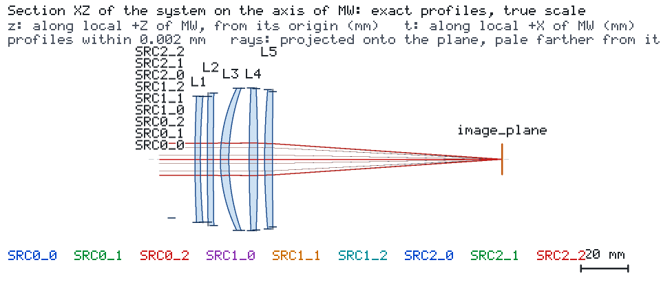
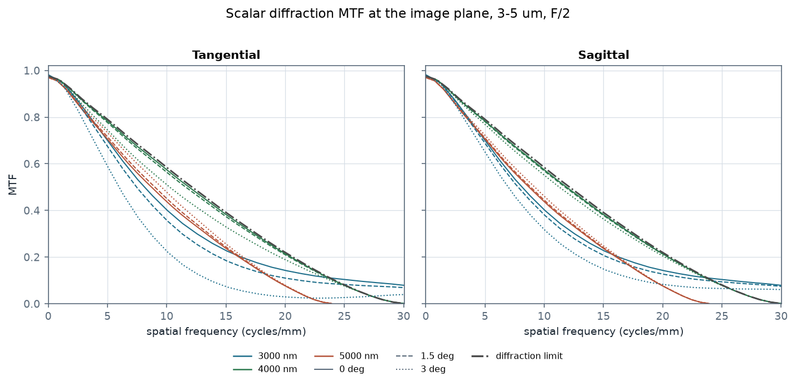
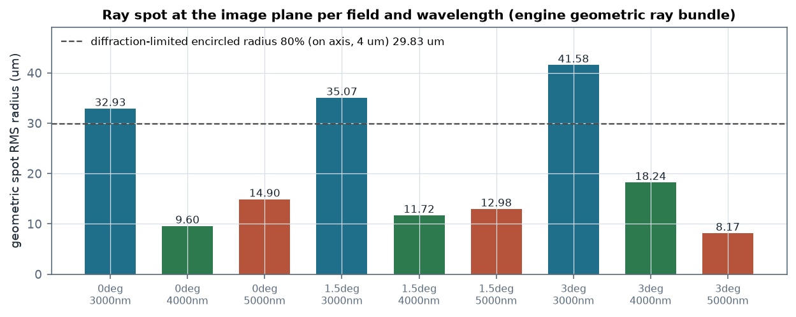
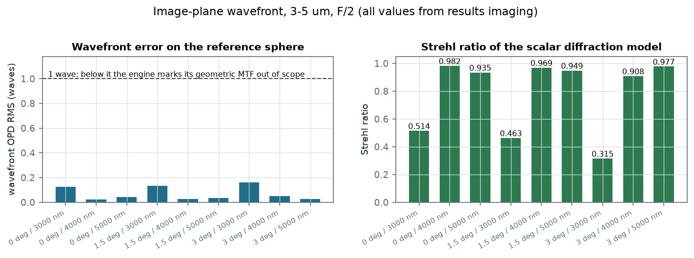

# 可制造厚度的五片中波红外成像镜头

一个中波红外折射成像镜头：Si、ZnSe、CaF2、Si、ZnSe 五片，F/2，EFL 100 mm，半视场 3°，在 3、4、
5 µm 三个波长上评价。本案例要说明两件事，而且引擎让这两件事同时可见：设计被约束在磨边能做出来
的厚度范围内；像质由引擎的**标量衍射**模型给出，而不是由弥散斑给出。

## 设计



光阑在首片之前，开孔 25 mm；对 100 mm 焦距而言这就是 F/2。每片玻璃的中心厚约束在 2–12 mm、
边缘厚约束在 1.5–3 mm，所有空气间隔在边缘处保持正值：

| 片 | 材料 | 通光半径 | 中心厚 | 边缘厚 |
| --- | --- | --- | --- | --- |
| L1 | Si | 26.80 mm | 2.29 mm | 2.71 mm |
| L2 | ZnSe | 26.79 mm | 2.54 mm | 2.46 mm |
| L3 | CaF2 | 30.32 mm | 3.62 mm | 1.87 mm |
| L4 | Si | 30.25 mm | 3.59 mm | 2.25 mm |
| L5 | ZnSe | 28.93 mm | 3.37 mm | 2.25 mm |

## 引擎给出的结果

九条光束（三个视场 × 三个波长）全部到达像面，运行在模型范围内，没有光束被光阑部分拦截。引擎的
衍射模型接受了全部九个视场：

| 量 | 值 |
| --- | --- |
| `launch_radius_beam_radii` | 1.0 |
| `image_space_na` | 0.060 |
| 衍射 MTF（轴上、4 µm、10.3 cycles/mm） | 0.561 |
| 同频率的衍射极限 | 0.571 |
| Strehl 比，4 µm 与 5 µm 全部视场 | 0.908–0.982 |
| Strehl 比，3 µm 全部视场 | 0.315–0.514 |
| 弥散斑 RMS 半径，4 µm 与 5 µm | 8.2–18.2 µm |
| 弥散斑 RMS 半径，3 µm | 32.9–41.6 µm |

**先读 `image_space_na`，再看它旁边那些数。** 0.060 不是 F/2：请求只发射一个光源光束半径宽的
圆盘，所以衍射模型评估的是光阑锥的**近轴核心**；若覆盖整个孔径，1/(2·2) = 0.25。把发射盘放大
到整个光阑会改变被测对象——采样会移到边缘区，那里波前误差更大，引擎的杂散光检索也会让运行时
间成倍增长。因此本案例**声明它评估的是哪一个孔径**，而不是给出一个它并没有的全孔径数字。下面的
MTF 曲线就是这个被测锥的衍射 MTF。



传递函数在整条波段上都贴近衍射极限：10.3 cycles/mm 处，轴上 4 µm 是 0.561，极限是 0.571；
4 µm 的 3° 视场是 0.495。3 µm 上剩下的那部分，是厚度约束带来的代价——能压到更小弥散斑的方案靠
厚弯月的厚度承载光焦度，而本案例的厚度约束不允许。



## 本案例显式呈现的两个引擎行为

**在这里几何 MTF 是错的指标，而且引擎自己也这么说。** 每个视场的 `geometric_mtf_*` 都返回
`OUT_OF_MODEL_SCOPE`，原因是 `GEOMETRIC_REGIME_NOT_MET`：*"the wavefront error (0.126 waves
RMS) is below 1.0 wave: diffraction sets the MTF here, and the diffraction MTF is the one to
read"*。像质越好，几何 MTF 越不成立——它的前提本来就是大像差。若为一个波前远优于 1 wave 的镜头
报告光线 MTF，引用的就是引擎拒绝为之背书的量。

**运行状态是 WARNING，这是引擎的性质，不是镜头的缺陷。** 引擎的杂散光检索在玻璃体内沿每条反射
分支做无界递归，因此任何透射镜头最终都会耗尽路径预算：

| 项 | 值 |
| --- | --- |
| `exhausted` | `["max_paths"]` |
| `exhausted_by_phase` | `{"untraced_light": ["max_paths"]}` |
| `UNTRACED_REFLECTION` 中的功率 | 0.00900 W 中的 0.00806 W |
| 像面处功率 | 0.00094 W，每一行 `conserved: true` |

主光束被完整追迹：九个光源全部 `DETECTED`，九条目标全部 MET，未计入的功率是未镀膜表面的部分
反射，引擎把它记为 sink 而不是追下去。把 `max_paths` 调大只会让运行更久，不会改变答案。



## 复现

```bash
os-optics project check project.json
os-optics project run project.json --out-dir run
os-optics results targets run
os-optics results imaging run --monitor image_plane --request imaging-request.json
```

`data/engine-midwave.json` 收录了引擎为这次运行产出的每一个量，连同它的状态、依据，以及引擎拒绝给出
时的 `reason` 与 `message` 原文。`expected.json` 记录运行状态与每条目标的判定。

`prescription.csv` 可直接导入：

```bash
os-optics project import-prescription prescription.csv --model-id MW
```
