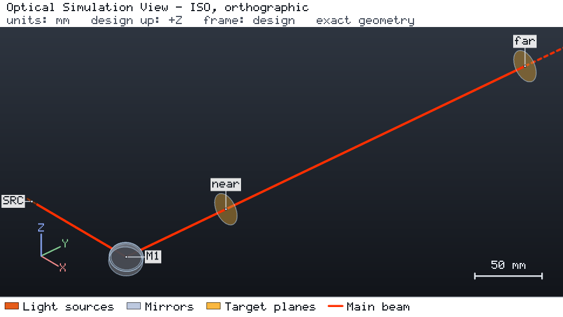
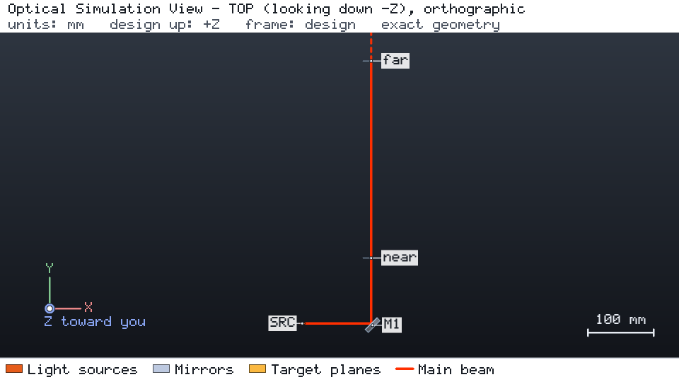

# Beam position and pointing after a fold mirror

[简体中文](README.zh-CN.md)

A 633 nm Gaussian beam (0.5 mm waist radius) meets the flat mirror `M1` at 45° and folds into design +Y. Two
observation planes, `near` at 100 mm and `far` at 400 mm after the mirror, read the beam position and direction.
The targets keep both positions within ± 0.1 mm and the far pointing within ± 0.5 mrad.





Both views are the engine's browser-free snapshots of a run of `project.json`:
`os-optics view run --no-browser --snapshot DIR` with `--views iso --size 960x540`, and again with
`--views top --size 960x540`. In a kit checkout, `os-optics-kit cases images mirror-alignment` re-renders
exactly these views as recorded in `images.json`.

## Run it

```bash
os-optics-kit cases copy mirror-alignment --dest .
cd mirror-alignment
os-optics project run project.json --out-dir run
os-optics results targets run
python workflow.py --out wf
```

## Results

| Target | Value | Bound | Assessment |
| --- | --- | --- | --- |
| `near_position_u`, `near_position_v` | 0 mm | ± 0.1 mm | MET |
| `far_position_u`, `far_position_v` | 0 mm | ± 0.1 mm | MET |
| `far_pointing_u`, `far_pointing_v` | 0 | ± sin 0.5 mrad | MET |

The nominal design is aligned: every position and direction cosine is zero to rounding, all six targets MET.

| Study | Values | PASS | FAIL | Notes |
| --- | --- | --- | --- | --- |
| `mirror_tilt_local_y_mrad` | −1 … 60 | 2 | 5 | 0.25 mrad misses only the far position; 60 mrad misses the far plane |
| `source_offset_z_mm` | 0.05, 0.15 | 1 | 1 | a pure offset: pointing stays 0 |
| `mirror_tilt_local_x_mrad` | −0.25, 0.1, 0.5 | 1 | 2 | out of the plane of incidence: 2θ·cos 45° |

All 122 compared values agree with exact vector reflection and the small-angle 2θ law. The synthetic-measurement
variant (`--synthetic-measurements`, rows labelled SYNTHETIC) fits positions on five planes and recovers a 1 mrad
mirror tilt as 1.997 ± 0.018 mrad of pointing (expected 2 mrad). The seeded tolerance study
(`os-optics-kit tolerance studies/tolerance_alignment.json --out tolerance`) passes 64 of 100 samples.

Verified with os-optics 0.13.0; run status PASS.
