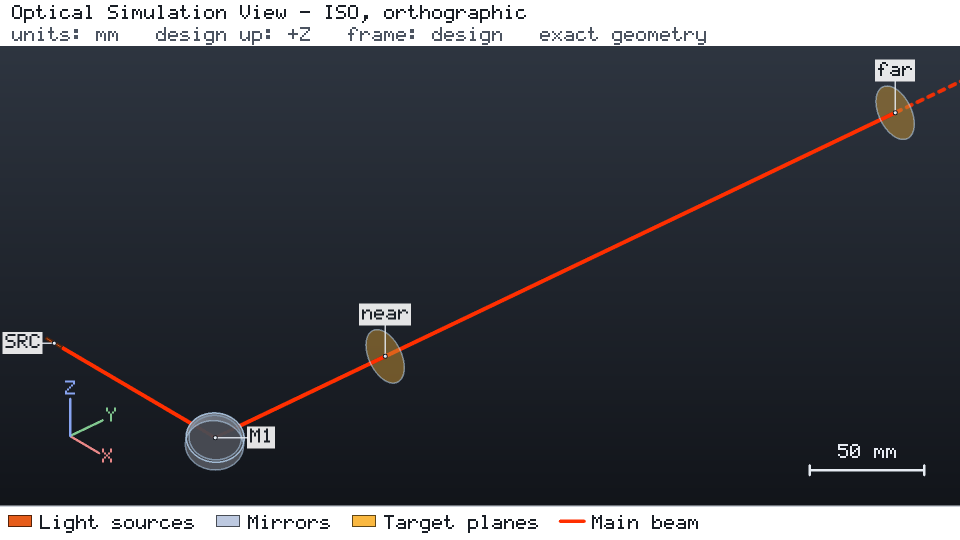
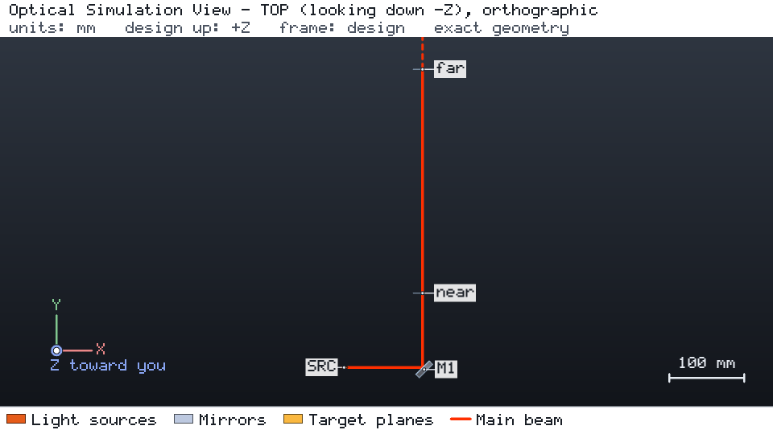

# 折返镜后的光束位置与指向

[English](README.md)

波长 633 nm 的高斯光束（束腰半径 0.5 mm）以 45° 入射平面镜 `M1`，折向设计 +Y。镜后 100 mm 的 `near` 面与 400 mm 的
`far` 面读取光束位置与方向。目标要求两个面上的位置都在 ± 0.1 mm 以内，远面指向在 ± 0.5 mrad 以内。





两幅视图均为引擎对 `project.json` 一次运行的无浏览器快照：`os-optics view run --no-browser --snapshot DIR` 加 `--views iso --size 960x540` 运行一次，再加 `--views top --size 960x540` 运行一次。
在 kit 检出目录中，`os-optics-kit cases images mirror-alignment` 会按 `images.json` 中的记录原样重新渲染这些视图。

## 运行

```bash
os-optics-kit cases copy mirror-alignment --dest .
cd mirror-alignment
os-optics project run project.json --out-dir run
os-optics results targets run
python workflow.py --out wf
```

## 结果

| 目标 | 数值 | 界限 | 评估 |
| --- | --- | --- | --- |
| `near_position_u`, `near_position_v` | 0 mm | ± 0.1 mm | MET |
| `far_position_u`, `far_position_v` | 0 mm | ± 0.1 mm | MET |
| `far_pointing_u`, `far_pointing_v` | 0 | ± sin 0.5 mrad | MET |

标称设计已对准：各位置与方向余弦在舍入误差内为零，六个目标全部 MET。

| 研究 | 取值 | PASS | FAIL | 说明 |
| --- | --- | --- | --- | --- |
| `mirror_tilt_local_y_mrad` | −1 … 60 | 2 | 5 | 0.25 mrad 仅远面位置超差；60 mrad 时光束到不了远面 |
| `source_offset_z_mm` | 0.05, 0.15 | 1 | 1 | 纯平移：指向保持为 0 |
| `mirror_tilt_local_x_mrad` | −0.25, 0.1, 0.5 | 1 | 2 | 入射面外倾斜：2θ·cos 45° |

参与比较的 122 个数值全部与精确矢量反射和小角度 2θ 定律一致。合成测量变体（`--synthetic-measurements`，数据行标记为
SYNTHETIC）在五个面上拟合位置，把 1 mrad 的镜面倾斜还原为 1.997 ± 0.018 mrad 的指向（期望 2 mrad）。带固定种子的公差研究
（`os-optics-kit tolerance studies/tolerance_alignment.json --out tolerance`）在 100 个样本中有 64 个通过。

已用 os-optics 0.13.0 验证；运行状态 PASS。
