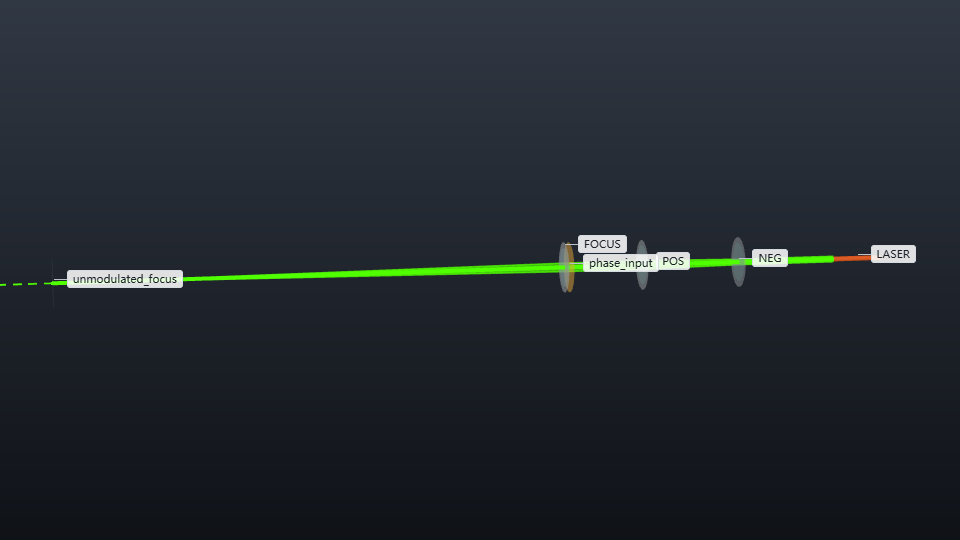

# Circular flat-top shaping and input-width sensitivity

How well does a phase-only flat-top design tolerate a change in illumination width? This case designs one circular pattern and evaluates the same mask after reducing the source waist by 10%. The core intensity coefficient of variation (CV) rises from **0.01197 to 0.07450**, even though almost all power remains in the target region.



The native optical system uses a 532 nm, 10 mW TEM00 source with a 0.5 mm waist, an ideal −40/+60 mm telescope, and an ideal 100 mm Fourier lens. The engine exports a TEM00 handoff 1 mm before that lens, with a 0.750275 mm beam radius. The external calculation propagates this field by 1 mm, applies the phase mask at the lens plane, and computes its back-focal-plane field. The native focus and layout describe the unmodulated reference; the saved external field supplies the flat-top result.

## Run and change a parameter

Use **Python 3.12 or newer** for the pinned scientific dependencies (verified with Python 3.14.8). Install os-optics 0.13.0 and os-optics-kit 0.3.0, copy this case, then run inside the copied directory:

```bash
python -m pip install -r requirements-flat-top.txt
python workflow.py --out out/default
python workflow.py --out out/wider --width-scale 1.1
python workflow.py --out out/larger --radius-mm 0.45
python workflow.py --out out/default --redraw
```

The first command computes the nominal illumination and a 0.9× source-waist variant. `--width-scale` changes the source waist through a second native run, then uses the **fixed nominal mask**, including its original wavefront correction. `--radius-mm` redesigns the mask for a different target radius. Use a new output directory for each calculation. `--redraw` reads saved arrays and creates the preview without running the engine or optimizer. Default computation, including verification, took about 7 seconds on the recorded Windows environment.

## Read the result

The target intensity is proportional to `exp(-2*(r/0.42 mm)^16)`. CV is the standard deviation divided by the mean intensity over `r < 0.315 mm` (75% of the target radius). The power fraction integrates intensity where the target exceeds 10% of its peak, divided by the total sampled focal-plane power. These are dimensionless quantities; the field intensity is in W/mm².

| Illumination | Core CV | Target-region power fraction |
| --- | ---: | ---: |
| Designed input | 0.0119713 | 0.9948493 |
| Source waist ×0.9, fixed mask | 0.0745046 | 0.9970254 |

Both outputs integrate to 10 mW. A high captured power fraction does not guarantee uniform illumination. Open `preview.png` to compare the shared-scale intensity maps and center profiles; the narrower input produces a central intensity excess.

Smooth radial energy transport initializes the phase. The 251 Gerchberg–Saxton updates minimize the whole target's relative squared intensity error: 0.00059689 → 0.00009383. The smooth initial field already has core CV 0.00495 and power fraction 0.98976. Optimization improves target agreement and power fraction while increasing core CV to 0.01197; CV is an observed tradeoff, not the optimization objective.

## Model and checks

The native target checks illumination radius 0.749–0.752 mm. The external model is monochromatic, coherent, scalar and paraxial, with a continuous lossless phase mask and ideal lens. It retains the handoff's power and curvature. The 384×384 pupil grid spans 4.608 mm; its focal sample spacing is 0.011545 mm. An actual pixelated mask would require its pixel pitch, phase levels, fill factor and transmission as additional inputs.

The workflow checks the native handoff against independent complex-q propagation, Fourier amplitudes against direct quadrature, and both fields for power conservation. Evaluating the fixed mask at half the pupil pitch gives a focal-intensity relative L2 difference of 3.90×10⁻⁶ within `r < 0.525 mm`. This check interpolates the complex phase factor, holds the physical window fixed, and does not re-optimize. The default also requires CV below 0.02 and target-region fraction above 0.99. `os-optics-kit cases verify phase-only-flat-top` checks the native target; run the workflow for the external optical result.

## Saved data

- `native-default/`, `native-width-variant/`: complete engine runs; the associated handoff JSON files preserve the optical input boundary.
- `science.npz`: pupil/focal coordinates in mm, incident and output complex fields in √(W/mm²), fixed phase mask in radians, unit-sum target, initial output, and iteration loss. Two-dimensional arrays use `(y, x)` order.
- `configuration.json`: physical parameters, ROI definitions, phase convention and mask identity.
- `results.json`: native identities/targets, external observables, independent checks, dependency versions and measured compute time.

Keep generated runs and arrays in your chosen output directory. The case files can be copied independently with `os-optics-kit cases copy phase-only-flat-top --dest DEST`.

## Present saved results

With Chrome/Chromium installed, create a fresh output folder for each style:

```bash
python present_case.py out/default --out figures/en --bundle figures/flat-top-en.zip
python present_case.py out/default --out figures/zh --language zh-CN
python present_case.py out/default --out figures/dark --language zh-CN --background dark
```

Open `index.html` locally. The gallery includes a native system view, the native illumination-radius comparison, and external intensity maps plus center profiles with a shared physical scale. PNG, SVG, bilingual captions, numeric data, input hashes, units and redraw settings accompany the plots. Chinese drawing needs a CJK font, such as Microsoft YaHei or Noto Sans CJK SC. The helper reads saved results, verifies CV/power against the saved fields and never runs the engine or optimizer. Source files remain unchanged.

Kit 0.3.0 `present` accepts native run/study plots, not arbitrary external fields. The helper uses its public theme and gallery APIs for the external plot. The +Z native system view uses public `render_shots` with +Y up because `present` views do not expose an up-axis setting. `presentation.json` therefore rebuilds only the native target plot; run this case helper for the complete gallery. The variant native target is scaled with source width; the external phase mask remains fixed.

The ZIP is an offline viewing bundle. To redraw its external figure without original run directories, extract it and use the included helper and data:

```bash
python assets/flat-top/present_case.py --redraw-external assets/flat-top/case-redraw.json --out redrawn --language zh-CN --background dark
```

Full native redraw still requires the saved native runs. The Python dependencies above and Chrome/Chromium support the documented workflow.
