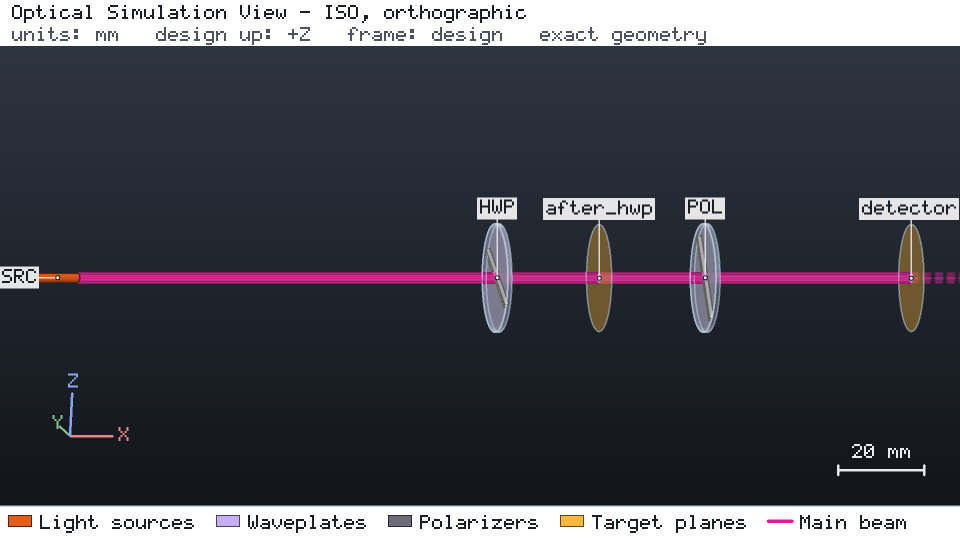

# Polarization control

A linearly polarized 1030 nm laser (1 mW, polarization along design +Y) passes a half-wave plate and a linear
polarizer. With the plate's fast axis at 22.5° the polarization turns to 45°, the polarizer's transmission axis, and
0.891 mW reaches the detector (plate transmittance 0.99, polarizer 0.9). The design is catalog-free and fully
parameterized: `workflow.py` rebuilds it from your inputs.



## Run it

```bash
os-optics-kit cases copy polarization-control --dest .
cd polarization-control
os-optics project run project.json --out-dir run
python workflow.py --out wf
```

## Results

| Target | Value | Bound | Assessment |
| --- | --- | --- | --- |
| `transmitted_power` | 0.891 mW | ≥ 0.8 mW | MET |
| `output_azimuth` | 45° | 45° ± 0.5° | MET |

The default workflow runs 14 designs; all 94 compared values (power, azimuth, Stokes parameters) agree with Jones
calculus and Malus' law.

| Study | Values | PASS | FAIL | Out of model |
| --- | --- | --- | --- | --- |
| `hwp_angle_deg` | 0 … 67.5° | 1 (22.5°) | 7 | 0 |
| `wavelength_nm` | 1000 … 1100 | 3 | 0 | 2 (1064 and 1100 nm, outside the plate's band) |

Verified with os-optics 0.12.0; run status PASS.
