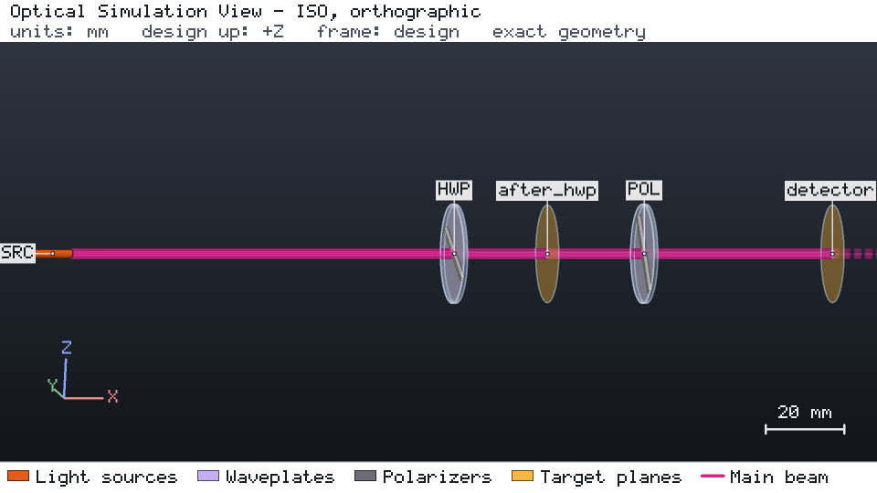

# 用半波片与偏振器控制偏振

[English](README.md)

波长 1030 nm 的线偏振激光（1 mW，偏振沿设计 +Y）依次经过半波片与线偏振器。半波片快轴位于 22.5° 时，偏振方向转到
45°，即偏振器的透光轴，探测面接收 0.891 mW（波片透过率 0.99，偏振器 0.9）。该设计不需要目录且完全参数化：
`workflow.py` 按你的输入重建设计。



该视图是引擎对 `project.json` 一次运行的无浏览器快照（`os-optics view run --no-browser --snapshot DIR --views iso --size 960x540`）。
在 kit 检出目录中，`os-optics-kit cases images polarization-control` 会按 `images.json` 中的记录原样重新渲染它。

## 运行

```bash
os-optics-kit cases copy polarization-control --dest .
cd polarization-control
os-optics project run project.json --out-dir run
os-optics results targets run
python workflow.py --out wf
```

## 结果

| 目标 | 数值 | 界限 | 评估 |
| --- | --- | --- | --- |
| `transmitted_power` | 0.891 mW | ≥ 0.8 mW | MET |
| `output_azimuth` | 45° | 45° ± 0.5° | MET |

默认工作流运行标称设计与 13 个研究样本；参与比较的 94 个数值（功率、方位角、斯托克斯参数）全部与琼斯矩阵计算和马吕斯定律
一致。

| 研究 | 取值 | PASS | FAIL | 超出模型 |
| --- | --- | --- | --- | --- |
| `hwp_angle_deg` | 0 … 67.5° | 1（22.5°） | 7 | 0 |
| `wavelength_nm` | 1000 … 1100 | 3 | 0 | 2（1064 与 1100 nm，超出波片波段） |

在 1064 与 1100 nm 处目标读数为 PASS，但波片仅在 1000–1060 nm 内有表征，因此运行超出模型
（`MODEL_WAVELENGTH_OUTSIDE_BAND`）。

已用 os-optics 0.13.0 验证；运行状态 PASS。
