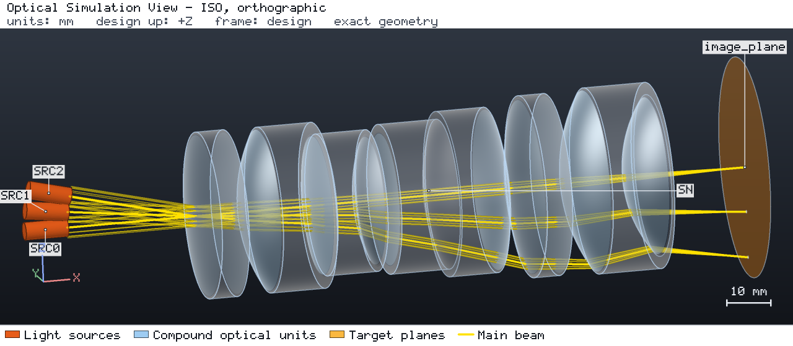
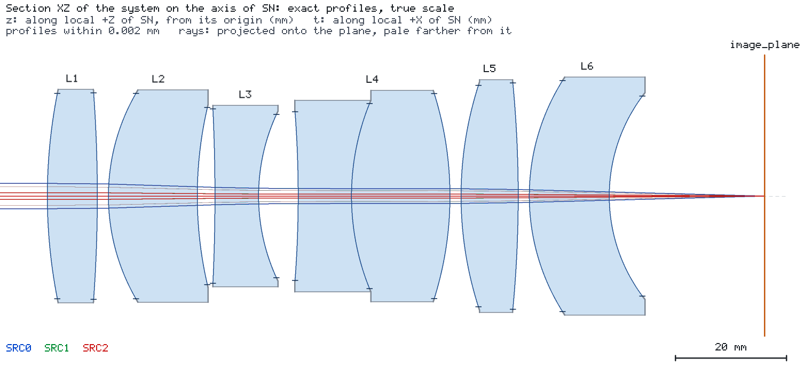
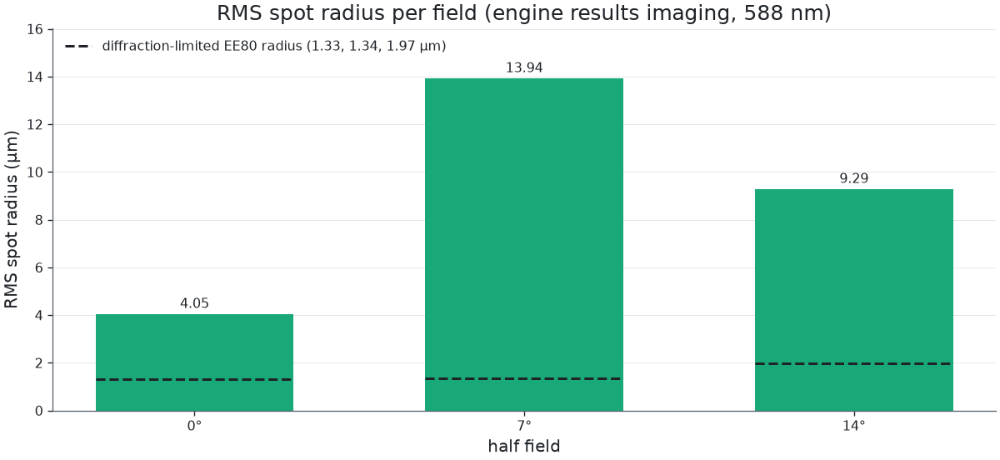
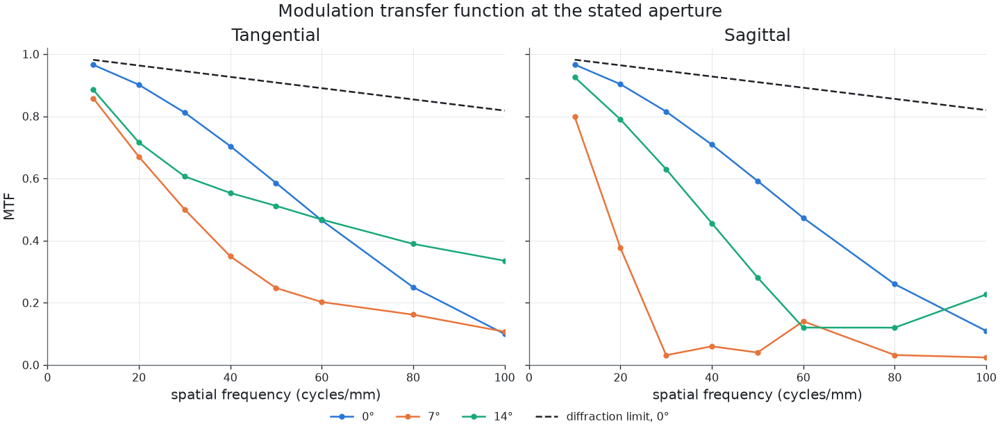

# Six-element Sonnar at f/2.4, measured across the full entrance pupil

[简体中文](README.zh-CN.md) · [Agent case sheet](CASE.md)

A six-element Sonnar: EFL 85 mm, f/2.4, half field 14° in visible light. This case runs the lens at
its **stated aperture** rather than in its paraxial core, and reports what the engine's imaging
analysis then returns.



## The design

`prescription.csv` is a `csv-surface-table/1` surface table of 13 surfaces forming six glass
elements. `project.json` imports it as a single COMPOUND unit and places the observation plane at
the paraxial rear focal point, x = 129.23 mm. The engine's paraxial solve gives **EFL 84.9999 mm**,
BFL 28.00 mm and FFD 56.07 mm.



| Surface | Radius (mm) | Thickness (mm) | Glass after it |
| --- | --- | --- | --- |
| S1 | 95.65 | 9.01 | N-BK7 |
| S2 | -259.14 | 2.00 | air |
| S3 | 36.99 | 16.01 | N-BK7 |
| S4 | 70.80 | 3.18 | air |
| S5 | -334.95 | 7.86 | F2 |
| S6 | 35.20 | 7.14 | air |
| S7 | -201.80 | 9.60 | F2 |
| S8 | 44.35 | 17.74 | N-BK7 |
| S9 | -61.50 | 2.00 | air |
| S10 | 65.13 | 10.29 | N-BK7 |
| S11 | -215.84 | 2.00 | air |
| S12 | 39.10 | 14.41 | F2 |
| S13 | 30.11 | 0.00 | image side |

Every clear radius is 14.7–20.8 mm; the mechanical (edge) radius is 0.6 mm larger, which keeps the
ground outline tight enough that the stray-light probe stays finite. The full table is in
`prescription.csv`; `input_prescription.csv` is the design it started from. From the first vertex to
the image plane the lens is 129.2 mm long, 1.52 times its focal length: a long-focus lens, but not a
telephoto layout (one shorter than its focal length).

## Measuring at the stated aperture

The entrance pupil of an f/2.4, 85 mm lens has radius 17.7 mm. The Project carries a 2 mm waist
Gaussian beam, so the launch disc is stated explicitly as **8.85 beam radii** in
`imaging-request.json`. Without that statement the beam is never clipped by any aperture, the engine
reports `PUPIL_NOT_BOUNDED`, and only the paraxial core (image-space NA 0.03) can be analysed.

Filled, the engine measures **image-space NA 0.2085**, against 0.208 for f/2.4 — the aperture is
genuinely open in the analysis, not nominal.

## How finely the PSF has to be sampled

`psf_samples` is not a cosmetic setting here. At **160** the engine's own
`diffraction_limited_encircled_radius_80` comes out at **12.85 µm** — 7.5 times the Airy radius
(1.72 µm at f/2.4, 588 nm), which cannot be right — and `window_light_share` integrates to **1.13**,
above the physical maximum. Both are undersampling artefacts. At **256** the same quantity reads
**1.33 µm** (0.77 × Airy) and the share settles at 0.9993; 512 changes neither. This case ships 256,
and 38 of 42 imaging quantities are KNOWN against 37 at 160.

## Results

`results imaging`, 588 nm, `launch_grid 256`, `psf_half_width_um 250`, `psf_samples 256`:

| Field | RMS spot (µm) | Strehl | OPD rms (λ) | EE80 (µm) | Diffraction-limit EE80 (µm) | RMS / limit | Image NA |
| --- | --- | --- | --- | --- | --- | --- | --- |
| 0° | 4.05 | 0.0603 | 0.328 | 6.61 | 1.33 | **3.06×** | 0.209 |
| 7° | 13.94 | 0.0175 | 1.195 | 28.10 | 1.34 | **10.37×** | 0.207 |
| 14° | 9.29 | 0.1228 | 0.461 | 11.81 | 1.97 | **4.73×** | 0.208 |





Read plainly: this is a **usable f/2.4 lens, not a diffraction-limited one**. On axis it reaches
4 µm RMS, about three times the diffraction-limited encircled-energy radius; the 7° field carries a
1.2-wave wavefront and is the weakest of the three; the 14° field recovers to 4.7× because the rear
group is oriented to balance the off-axis aberrations at the edge of the field. The image-space NA
is 0.2085 on every field, so all three numbers describe the whole stop.

## What the engine declines, and why

38 of 42 imaging quantities are KNOWN. The four outside their model are the geometric MTF of the 0°
and 14° fields, both `GEOMETRIC_REGIME_NOT_MET`:

| Quantity | Field | Reason |
| --- | --- | --- |
| `geometric_mtf_tangential` / `_sagittal` | 0° | `GEOMETRIC_REGIME_NOT_MET` |
| `geometric_mtf_tangential` / `_sagittal` | 14° | `GEOMETRIC_REGIME_NOT_MET` |

The engine declines them because those wavefronts (0.328 λ and 0.461 λ RMS) are below one wave, and
states that the diffraction MTF is the one to read. **That refusal is a property of the design, not
a defect of the run**: the geometric MTF assumes the aberration dominates, so the better the
wavefront, the less the approximation holds. The 7° field carries 1.195 waves and therefore keeps
its geometric MTF as well.

## Run status

The run is `PARTIAL` with validation status `WARNING`. The engine's untraced-light enumeration — a
recursive probe that follows ghost reflections and clipped light — stopped on its path budget. That
probe is a **different model** from the imaging quantities: it asks whether light could reach a
plane that no traced beam reaches, and it is unbounded for any transmissive prescription because the
probe can keep re-entering the glass. The imaging quantities are all KNOWN and independent of it.

The power ledger balances: `conserved true`, residual 2.1e-16 W. Each uncoated glass-to-air
interface reflects its Fresnel share, which the engine records as a sink rather than following, and
the imaging quantities are weighted by the amplitude those interfaces transmit.

## Reproduce

```bash
os-optics project check project.json
os-optics project run project.json --out-dir run
os-optics results targets run
os-optics results imaging run --monitor image_plane --request imaging-request.json
os-optics view run --no-browser --snapshot views --views iso --size 1280x560
os-optics view run --no-browser --snapshot views --section ALL --size 1600x700
python figures.py run --out images
```

The 3D view and the section are the engine's snapshots of a run of `project.json` (the two `os-optics view`
lines above, with the recorded options; in a kit checkout `os-optics-kit cases images sonnar-telephoto-lens`
re-renders them exactly as recorded in `images.json`). `figures.py` draws the spot and MTF figures from that
run with the same `results imaging` call (matplotlib comes with `pip install "os-optics-kit[plot]"`).

`os-optics-kit cases verify sonnar-telephoto-lens` repeats the run and compares the target
assessments with `expected.json`.
