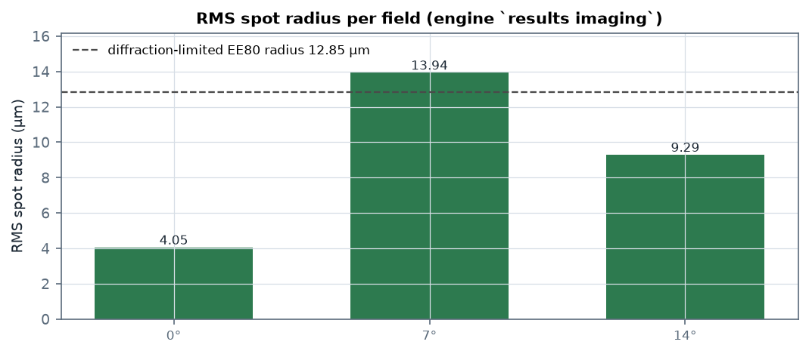
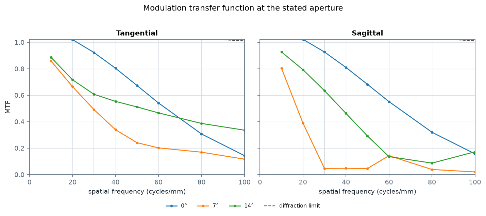
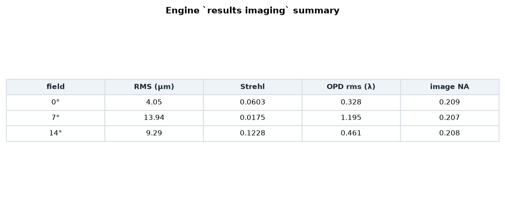

# f/2.4 六片 Sonnar，在完整入瞳上测量

六片 Sonnar：EFL 85 mm、F/2.4、半视场 14°，可见光。本案例在**标称光圈**下运行该镜头，
而不是只在它的近轴核心上取样，然后报告引擎成像分析返回的结果。



## 设计

`prescription.csv` 是 `csv-surface-table/1` 格式的面表，13 个面组成 6 片玻璃。
`project.json` 把它导入为一个 COMPOUND 单元，并把观察面放在近轴后焦点 x = 129.23 mm。
引擎的近轴解给出 **EFL 84.9999 mm**、BFL 28.00 mm、FFD 56.07 mm。

| 面 | 半径 (mm) | 厚度 (mm) | 其后介质 |
| --- | --- | --- | --- |
| S1 | 95.65 | 9.01 | N-BK7 |
| S2 | -259.14 | 2.00 | 空气 |
| S3 | 36.99 | 16.01 | N-BK7 |
| S4 | 70.80 | 3.18 | 空气 |
| S5 | -334.95 | 7.86 | F2 |
| S6 | 35.20 | 7.14 | 空气 |
| S7 | -201.80 | 9.60 | F2 |
| S8 | 44.35 | 17.74 | N-BK7 |
| S9 | -61.50 | 2.00 | 空气 |
| S10 | 65.13 | 10.29 | N-BK7 |
| S11 | -215.84 | 2.00 | 空气 |
| S12 | 39.10 | 14.41 | F2 |
| S13 | 30.11 | 0.00 | 像方 |

各面通光半径 15.7–20.8 mm；机械（磨边）半径大 0.6 mm，使磨边轮廓足够紧凑，
杂散光探针的分支数保持有限。完整面表见 `prescription.csv`，`input_prescription.csv` 是起始设计。

## 在标称光圈上测量

f/2.4、85 mm 镜头的入瞳半径是 17.7 mm。工程里带的是 2 mm 腰斑的高斯光束，
因此在 `imaging-request.json` 里把发射盘显式写成 **8.85 个光束半径**。
若不写这一项，光束不会被任何口径截断，引擎会报 `PUPIL_NOT_BOUNDED`，
只能分析近轴核心（像方 NA 0.03）。

填满之后，引擎实测**像方 NA = 0.2085**，而 f/2.4 的理论值是 0.208 ——
也就是说光圈在分析中是真的开着的，不是名义值。

## PSF 必须采样多细

`psf_samples` 在这里不是装饰性设置。取 **160** 时，引擎自己的
`diffraction_limited_encircled_radius_80` 报出 **12.85 µm** —— 是 Airy 半径
（f/2.4、588 nm 下 1.72 µm）的 7.5 倍，这在物理上不可能；同时 `window_light_share`
积分到 **1.13**，超过物理上限。两者都是采样不足的伪影。
取 **256** 时同一个量变成 **1.33 µm**（0.77 × Airy），窗口光占比落到 0.9993；再取 512 两者都不再变化。
本案例采用 256，成像量 KNOWN 从 160 时的 37 升到 **38**。

## 结果

`results imaging`，588 nm，`launch_grid 256`、`psf_half_width_um 250`、`psf_samples 256`：

| 视场 | RMS 光斑 (µm) | Strehl | OPD rms (λ) | EE80 (µm) | 衍射极限 EE80 (µm) | RMS / 极限 | 像方 NA |
| --- | --- | --- | --- | --- | --- | --- | --- |
| 0° | 4.05 | 0.060 | 0.328 | 6.61 | 1.33 | **3.06×** | 0.209 |
| 7° | 13.94 | 0.018 | 1.195 | 28.10 | 1.34 | **10.37×** | 0.207 |
| 14° | 9.29 | 0.123 | 0.461 | 11.81 | 1.97 | **4.73×** | 0.208 |



直白地读：这是**一个可用的 f/2.4 镜头，但不是衍射极限级**。轴上 4 µm RMS，约为衍射极限
包围圆半径的 3 倍；7° 视场带 1.2 波波前，是三个视场里最弱的；14° 视场回到 4.7 倍，
因为后组是按视场边缘平衡离轴像差配置的。三个视场的像方 NA 都是 0.2085，
所以这三个数描述的都是整圈光阑。



## 引擎拒绝给出、以及为什么

42 个成像量里 38 个 KNOWN，超出模型范围的 4 个是 0° 与 14° 视场的几何 MTF，
原因都是 `GEOMETRIC_REGIME_NOT_MET`：

| 量 | 视场 | 原因 |
| --- | --- | --- |
| `geometric_mtf_tangential` / `_sagittal` | 0° | `GEOMETRIC_REGIME_NOT_MET` |
| `geometric_mtf_tangential` / `_sagittal` | 14° | `GEOMETRIC_REGIME_NOT_MET` |

引擎拒绝它们，是因为这两个波前（0.328 λ 与 0.461 λ RMS）都低于一个波长，
并明确指出此时应当读衍射 MTF。**这个拒绝是设计的属性，不是运行的缺陷**：
几何 MTF 的前提是像差占主导，波前越好，这个近似越不成立。
7° 视场带 1.195 波，因此它的几何 MTF 也保留了下来。

## 运行状态

运行是 `PARTIAL`、验证状态 `WARNING`。引擎的未追踪光枚举 —— 一个递归跟随鬼像反射与被裁光线的探针
—— 在路径预算上停止了。那个探针是**另一个模型**：它回答的是"有没有光可能到达一条已追踪光束到不了的平面"，
而对任何透射式处方它的深度都无界（探针可以反复进入玻璃体内）。成像量与它无关，全部 KNOWN。

功率账本守恒：`conserved true`，残差 2.1e-16 W。每个未镀膜的玻璃-空气界面都会反射其菲涅耳份额，
引擎把它记为 sink 而不继续追；而成像量按这些界面实际透过的振幅加权。

## 复现

```bash
os-optics project check project.json
os-optics project run project.json --out-dir run
os-optics results targets run
os-optics results imaging run --monitor image_plane --request imaging-request.json
```

`os-optics-kit cases verify sonnar-telephoto-lens` 会重跑并把目标评估与 `expected.json` 比对。